# Product Requirement Document (PRD): Web APMA (Asosiasi Profesi Marketing Asuransi)

**Versi:** 2.0.0  
**Tanggal Pembaruan:** 05 September 2026  
**Status:** Draf Final Terintegrasi / Sesuai Implementasi Kode Aktif  
**Teknologi Utama:** Node.js (Express.js), MySQL (`mysql2/promise`), Multer, Bcrypt, Nodemailer, Vanilla HTML5/CSS3 (Plus Jakarta Sans, Font Awesome 6)

---

## 1. Ringkasan Eksekutif & Visi Produk

### 1.1 Visi Produk
Web **APMA (Asosiasi Profesi Marketing Asuransi)** dirancang sebagai ekosistem platform digital terpadu untuk memberdayakan dan meningkatkan kredibilitas profesional para pemasar asuransi umum serta praktisi pemasaran digital di Indonesia. Platform ini memfasilitasi pendaftaran keanggotaan digital, dasbor personal terakreditasi, jaringan networking B2B direktori anggota, pusat sumber daya eksklusif, kalender kegiatan & ticketing interaktif, serta program sertifikasi profesi nasional berstandar BNSP.

### 1.2 Tujuan Utama
1. **Dasbor Personal & E-Card Digital:** Memberikan kontrol penuh bagi anggota untuk mengedit profil profesional, memantau status keanggotaan aktif (*Executive/Professional Member*), melacak riwayat pembayaran/iuran berkwitansi resmi, dan mengunduh E-Card Holografik 3D dengan QR Code.
2. **Direktori Anggota & B2B Networking:** Menyediakan database pencarian anggota interaktif berdasarkan lokasi, spesialisasi keahlian (*Performance Marketing, Brand Strategy, PR, Creative*), dan jabatan dengan fasilitas direct chat WhatsApp/LinkedIn.
3. **Pusat Sumber Daya Eksklusif (Resource Center):** Menyediakan repositori materi terstandarisasi yang dapat diunduh (rekaman webinar, template kontrak hukum agensi/MSA/NDA, spreadsheet media plan, studi kasus industri).
4. **Kalender Kegiatan & Sistem Ticketing Dinamis:** Menghadirkan kalender visual bulanan interaktif serta sistem ticketing dengan pembedaan harga otomatis (Anggota = *Gratis / Diskon Subsidi*, Non-Anggota = *Harga Penuh*) dan penerbitan E-Ticket Digital ber-QR Code.
5. **Program Sertifikasi Profesi & Portal Validasi Perekrut:** Menyajikan kurikulum berjenjang KKNI/BNSP, jadwal batch ujian asesmen, serta portal pencarian verifikasi lisensi resmi untuk memvalidasi kredensial kandidat oleh HRD/Perekrut.
6. **Otomatisasi Kredensial & CMS Pengurus:** Penomoran otomatis (`APMA-YYYY-XXXX`), keamanan hashing password, audit log, notifikasi email sambutan, serta panel CMS admin untuk berita, agenda, dan regulasi.

---

## 2. Pengguna Target & Peran (User Roles)

| Peran Pengguna | Deskripsi | Hak Akses Utamanya |
|---|---|---|
| **Pengunjung / Publik** | Calon anggota, praktisi umum, dan pengunjung situs. | Menjelajahi landing page, membaca berita/artikel CMS, melihat agenda acara, mengunduh regulasi publik, dan mendaftar keanggotaan baru. |
| **Manajer HRD / Perekrut (Recruiter)** | Perusahaan, agensi, atau perekrut independen yang mencari/memvalidasi talenta pemasaran. | Mengakses **Portal Sertifikasi & Direktori Verifikasi Lisensi** (`certification.html`) untuk memeriksa keaslian nomor registrasi sertifikat kandidat secara *real-time*. |
| **Anggota (Member)** | Praktisi pemasaran terdaftar resmi di APMA. | Mengakses **Portal Anggota (`member_dashboard.html`)**, mengedit profil publik, mengunduh E-Card digital, memantau poin CPD, mengunduh kwitansi & sertifikat, mengakses direktori networking B2B, mengunduh materi Resource Center, serta mengklaim tiket event gratis. |
| **Administrator (Admin)** | Pengurus dan sekretariat asosiasi APMA. | Mengakses **Admin Center (`admin_dashboard.html`)**, memantau statistik anggota, menginput anggota baru, mempublikasikan berita, membuat agenda kegiatan, mengunggah dokumen regulasi, serta memverifikasi pengajuan poin CPD anggota. |

---

## 3. Fitur & Modul Fungsional Aplikasi

### Modul 1: Web Publik & Landing Page (`index.html`)
- **Navigasi Lengkap:** Beranda, Tentang Kami, Keanggotaan, Sertifikasi Profesi (`certification.html`), Pusat Informasi, Berita, Kontak, dan Portal Anggota.
- **Hero Banner:** Headline interaktif nilai tambah asosiasi dengan CTA Pendaftaran Anggota & Pelajari Benefit.
- **Berita & Pengumuman:** Menampilkan daftar artikel & pengumuman terbaru secara dinamis dari database (`/api/news`).
- **Pusat Regulasi Publik:** Akses dokumen publik bagi masyarakat dan praktisi umum (`/api/downloads?isLoggedIn=false`).

### Modul 2: Pendaftaran Anggota & Otomatisasi Backend (`public_register.html`, `admin_add_member.html`, `onAfterAdminInsertMember.js`)
- **Pendaftaran Mandiri (Public Registration):**
  - Form data pribadi: Nama Lengkap, Email, Nomor HP, Perusahaan, Tingkat Sertifikasi (Dasar / Madya / Utama).
  - Unggah dokumen persyaratan (Format: JPG, PNG, PDF, Maks: 2MB).
- **Penambahan Anggota oleh Admin & Otomatisasi (`onAfterAdminInsertMember`):**
  - **Penomoran Anggota Otomatis:** Format standar `APMA-2026-XXXX`.
  - **Hashing Password Aman:** Kata sandi sementara di-hash dengan `bcrypt` (10 rounds).
  - **Audit Logging:** Mencatat aksi `INSERT_NEW_MEMBER` ke log sistem dengan identitas admin penginput.
  - **Notifikasi Email Sambutan:** Pengiriman email HTML berisi nomor anggota dan kredensial via `Nodemailer`.

### Modul 3: Dasbor Personal Anggota (`member_dashboard.html` - Tab Personal & CPD)
- **E-Card Digital 3D Holografik:**
  - Kartu keanggotaan digital interaktif dengan efek 3D tilt, chip emas, logo APMA, nama anggota, nomor ID (`APMA-2026-0892`), dan QR Code verifikasi.
  - Tombol **Unduh E-Card Digital (PNG)**.
- **Pelacak Status Keanggotaan:**
  - Informasi Tier (*Executive Member*), Badge Status Aktif, tanggal kedaluwarsa keanggotaan, dan indikator sisa masa aktif.
- **Profil Anggota yang Dapat Diedit:**
  - Modal edit interaktif: Nama & Gelar, Jabatan, Perusahaan/Agensi, Spesialisasi Utama, Domisili/Kota, No. WhatsApp, LinkedIn, Bio Profesional, dan toggle status *Open for B2B Collab*.
  - Terintegrasi dengan endpoint `PUT /api/members/profile`.
- **Riwayat Pembayaran & Iuran:**
  - Tabel transaksi: No. Invoice, Deskripsi Iuran/Event, Tanggal Bayar, Nominal Rupiah, Metode Pembayaran (BCA VA / QRIS), Badge Lunas, dan tombol **Unduh Kwitansi (PDF)** (`/api/members/payments`).
- **Sertifikat yang Dimiliki:**
  - Grid sertifikat digital terakreditasi APMA & BNSP lengkap dengan nomor sertifikat, tanggal terbit, akumulasi poin CPD, dan tombol **Unduh Sertifikat (PDF)** (`/api/members/certificates`).
- **Pelacak & Pengajuan Poin CPD (Continuing Professional Development):**
  - Progress bar visual pencapaian poin CPD tahunan (target 30 poin/tahun).
  - Form pengajuan mandiri bukti pelatihan eksternal (`POST /api/members/cpd/submit`).
  - Tabel riwayat status pengajuan mandiri (`GET /api/members/cpd/submissions`).
  - Akumulasi dinamis event APMA + pengajuan approved (`GET /api/members/cpd/summary`).

### Modul 4: Direktori Anggota & B2B Networking (`member_dashboard.html` - Tab Directory)
- **Mesin Pencarian Real-Time:** Filter instan berdasarkan nama praktisi, nama agensi/perusahaan, dan keahlian spesifik.
- **Multi-Kriteria Filtering:**
  - **Lokasi:** DKI Jakarta, Surabaya, Bandung, Bali, Yogyakarta, Medan, dll.
  - **Spesialisasi:** *Performance Marketing*, *Brand Management*, *PR & Communications*, *Creative Strategy*, *MarTech & Data*.
  - **Jabatan:** *C-Level / Founder*, *Head / VP Marketing*, *Creative Director*, *Lead / Manager*.
  - **Opsi Kolaborasi:** Filter khusus anggota yang membuka kolaborasi B2B (*Open for B2B*).
- **Member Cards & Direct Networking:**
  - Avatar, badge spesialisasi, domisili, ringkasan keahlian, dan tombol direct link **Chat WhatsApp B2B** serta profil **LinkedIn**.

### Modul 5: Pusat Sumber Daya (Resource Center) (`member_dashboard.html` - Tab Resources)
- **Repositori Materi Eksklusif:**
  - 🎥 **Rekaman Webinar & Masterclass:** Video pembelajaran AI Agent marketing, durasi, dan nama narasumber.
  - 📄 **Template Kontrak Agensi:** *Master Services Agreement (MSA)*, *Client Retainer Agreement*, dan *Non-Disclosure Agreement (NDA)* standar legal.
  - 📋 **Brief Kampanye Standar:** *Omnichannel Media Plan Spreadsheet (Formula ROAS Otomatis)* dan *Integrated Campaign Brief Deck (PPTX)*.
  - 📊 **Studi Kasus Industri:** *Whitepaper* strategi FMCG D2C Indonesia dan *Global MarTech Stacks Benchmark*.
- **Fitur Unduh & Counter Real-Time:** Filter kategori, pencarian dokumen, dan tombol **Unduh Berkas** dengan pencatatan counter unduhan (`/api/resources/:id/download`).

### Modul 6: Kalender Kegiatan Interaktif & Sistem Ticketing (`member_dashboard.html` - Tab Calendar)
- **Kalender Visual Bulanan Interaktif:**
  - Grid tanggal kalender dengan penanda warna (*color-coded dots*) sesuai 4 jenis kegiatan:
    - 🎓 *Seminar & Masterclass*
    - 🛠️ *Lokakarya Teknis / Workshop*
    - 🏛️ *Rapat Umum Anggota (RUA / Munas)*
    - ☕ *Networking Kasual & Member Gathering*
  - Fitur klik tanggal kalender untuk memfilter agenda acara di hari tersebut.
- **Sistem Ticketing & Pembedaan Harga (Member vs Non-Member Pricing):**
  - **Anggota APMA:** Mendapatkan subsidi 100% (**Gratis**) atau tarif diskon khusus anggota.
  - **Non-Anggota:** Menampilkan tarif normal reguler.
  - Form pendaftaran instan (`POST /api/events/ticket-register`).
- **Penerbitan E-Ticket Digital:**
  - Menghasilkan E-Ticket resmi lengkap dengan Nomor Tiket Unik (`TKT-XXX-XXXXXX`), **QR Code Digital**, rincian sesi, dan tombol **Unduh E-Ticket (PDF)**.

### Modul 7: Program Sertifikasi Profesi & Validasi Perekrut (`certification.html`)
- **Kurikulum & Standar Kompetensi BNSP:**
  - *Certified Performance Marketing Specialist (CPMS)* (Jenjang 6 KKNI)
  - *Certified Strategic Brand Leader (CSBL)* (Jenjang 7 KKNI)
  - *Certified Corporate Communications & PR Practitioner (CCPR)* (Jenjang 6 KKNI)
  - Silabus unit kompetensi, durasi pelatihan, dan subsidi biaya anggota.
- **Jadwal Batch Ujian Asesmen:**
  - Tabel jadwal batch ujian Computer Based Test (CBT) dan asesmen portofolio, kuota peserta, dan form pendaftaran ujian online (`/api/certifications/register`).
- **Direktori Validasi Lisensi Perekrut (Recruiter Validation Hub):**
  - Mesin pencari nomor sertifikat / nama kandidat untuk memvalidasi otentisitas lisensi resmi, tanggal terbit, masa berlaku, dan asesor BNSP (`/api/certifications/verify`).

### Modul 8: Pusat Kontrol Admin (`admin_dashboard.html`)
- **Dashboard Statistik:** Total anggota terdaftar, total berita dipublikasi, agenda acara aktif, dan counter pengajuan CPD pending.
- **Verifikasi & Persetujuan Poin CPD Anggota:** Tabel pengajuan CPD masuk, filter status, preview bukti sertifikat, input jumlah poin yang disetujui, tombol Setujui dan Tolak.
- **CMS Pengurus:** Form tambah berita/pengumuman, pembuatan agenda acara, dan unggah dokumen regulasi.

---

## 4. Arsitektur REST API Endpoints

| Method | Endpoint | Deskripsi | Akses |
|---|---|---|---|
| `GET` | `/api/news` | Mengambil daftar berita berstatus *Published* (dengan fallback demo) | Publik |
| `POST` | `/api/news` | Mempublikasikan berita baru | Admin |
| `GET` | `/api/downloads` | Mengambil daftar dokumen regulasi publik / khusus anggota | Publik / Member |
| `POST` | `/api/downloads` | Mengunggah dokumen baru | Admin |
| `GET` | `/api/members/profile` | Mengambil data profil lengkap anggota | Member |
| `PUT` | `/api/members/profile` | Memperbarui data profil, kontak, dan spesialisasi anggota | Member |
| `GET` | `/api/members/payments` | Mengambil daftar riwayat transaksi & iuran anggota | Member |
| `GET` | `/api/members/certificates` | Mengambil daftar sertifikat digital yang dimiliki anggota | Member |
| `GET` | `/api/members/directory` | Mengambil direktori anggota dengan filter lokasi, spesialisasi, & jabatan | Member |
| `GET` | `/api/resources` | Mengambil materi eksklusif pusat sumber daya (kontrak, brief, studi kasus) | Member |
| `POST` | `/api/resources/:id/download` | Mencatat counter unduhan materi resource center | Member |
| `GET` | `/api/events/calendar` | Mengambil data kalender kegiatan & agenda acara | Publik / Member |
| `POST` | `/api/events/ticket-register` | Mendaftar tiket event dengan kalkulasi diskon anggota & cetak E-Ticket QR | Publik / Member |
| `GET` | `/api/certifications/programs` | Mengambil kurikulum dan silabus program sertifikasi | Publik / Member |
| `GET` | `/api/certifications/schedules` | Mengambil jadwal batch ujian asesmen kompetensi | Publik / Member |
| `GET` | `/api/certifications/verify` | Memvalidasi keaslian lisensi sertifikat untuk HR & Perekrut | Publik / HR |
| `POST` | `/api/certifications/register` | Mendaftarkan kandidat ke batch ujian sertifikasi | Publik / Member |
| `POST` | `/api/members/cpd/submit` | Mengajukan bukti kegiatan eksternal untuk klaim poin CPD mandiri | Member |
| `GET` | `/api/members/cpd/submissions` | Mengambil riwayat status pengajuan poin CPD mandiri anggota | Member |
| `GET` | `/api/members/cpd/summary` | Mengambil akumulasi total poin CPD tahunan anggota | Member |
| `GET` | `/api/admin/cpd/submissions` | Mengambil daftar pengajuan CPD masuk untuk diverifikasi admin | Admin |
| `PUT` | `/api/admin/cpd/submissions/:id/review` | Admin menyetujui (Approved) atau menolak (Rejected) poin CPD | Admin |
| `POST` | `/api/admin/add-member` | Menambah anggota baru secara manual & memicu trigger otomatisasi | Admin |

---

## 5. Skema Basis Data (Database Schema Relasional)

```mermaid
erDiagram
    users_membership ||--o{ member_profiles : "memiliki profil"
    users_membership ||--o{ member_payments : "melakukan pembayaran"
    users_membership ||--o{ member_certificates : "memperoleh sertifikat"
    users_membership ||--o{ cpd_submissions : "mengajukan poin CPD"
    users_membership ||--o{ event_registrations : "mendaftar tiket"
    events ||--o{ event_registrations : "memiliki peserta"
    certification_programs ||--o{ certification_exams : "memiliki jadwal ujian"
    
    users_membership {
        int id PK
        string full_name
        string email UK
        string password
        string member_id_number UK
        enum membership_status "Pending, Active, Suspended"
        enum role "Anggota, Admin"
        timestamp created_at
    }

    member_profiles {
        int profile_id PK
        int user_id FK
        string headline
        string company
        string position
        string specialization
        string location
        string phone
        string linkedin_url
        text bio
        string avatar_url
        enum membership_tier "Basic, Professional, Executive"
        date membership_expiry
        boolean open_for_collab
    }

    member_payments {
        int payment_id PK
        int user_id FK
        string invoice_number UK
        string description
        decimal amount
        string payment_method
        enum status "Paid, Pending, Failed"
        timestamp paid_at
        string receipt_url
    }

    member_certificates {
        int certificate_id PK
        int user_id FK
        string certificate_number UK
        string title
        string issuer
        date issue_date
        int cpd_points
        string download_url
    }

    cpd_submissions {
        int submission_id PK
        int user_id FK
        string event_name
        string provider_name
        date event_date
        decimal score
        int claimed_points
        int approved_points
        string certificate_url
        enum status "Pending, Approved, Rejected"
        text admin_notes
        timestamp submitted_at
        timestamp approved_at
        int approved_by
    }

    events {
        int event_id PK
        string event_title
        text description
        enum event_type "Webinar, Sertifikasi, Rapat Anggota, Workshop"
        date event_date
        time event_time
        string location_or_link
        int quota
        decimal price
        int cpd_points
        timestamp created_at
    }

    event_registrations {
        int registration_id PK
        int event_id FK
        int user_id FK
        enum payment_status "Free, Pending Payment, Paid, Cancelled"
        string payment_proof
        enum attendance_status "Registered, Attended, Absent"
        timestamp registered_at
    }

    certification_programs {
        int program_id PK
        string code UK
        string title
        string level
        text description
        decimal price_member
        decimal price_non_member
        int duration_weeks
    }

    certification_exams {
        int exam_id PK
        int program_id FK
        string batch_name
        date exam_date
        time exam_time
        string exam_type
        string lead_assessor
        int quota
        int registered_count
        enum status "Open, Full, Completed"
    }

    download_center {
        int doc_id PK
        string document_title
        text description
        enum category "Webinar Replay, Template Kontrak, Brief Kampanye, Studi Kasus, Regulasi Asosiasi"
        string file_type
        string file_size
        string file_path
        enum access_level "Publik, Khusus Anggota"
        int download_count
        timestamp uploaded_at
    }

    cms_news {
        int news_id PK
        string title
        string slug UK
        text content
        enum category "Berita Asosiasi, Artikel, Pengumuman Resmi"
        string author_name
        enum status "Draft, Published"
        timestamp created_at
    }
```

---

## 6. Persyaratan Non-Fungsional (Non-Functional Requirements)

1. **Keamanan & Kredensial:**
   - Proteksi hashing kata sandi via `bcrypt` (10 rounds).
   - Sanitasi upload file melalui `multer` (ekstensi valid: `.jpg`, `.jpeg`, `.png`, `.pdf`, `.docx`, `.xlsx`, batas: 2MB).
   - Parameterized SQL query (`mysql2/promise`) terhadap seluruh input database.
2. **Ketersediaan & Fallback Cerdas:**
   - Server backend (`app.js`) dilengkapi dataset in-memory demo yang tangguh sehingga seluruh modul (Dashboard, Kalender, Direktori, Sertifikasi) dapat beroperasi lancar baik saat MySQL terhubung maupun dalam mode demonstrasi offline.
3. **Desain UI/UX & Aksesibilitas:**
   - Tampilan visual modern dengan palette warna: Indigo Electric (`#4361ee`), Crimson Maroon (`#991b1b`), Deep Navy (`#0f172a`), dan Gold Accent (`#d97706`).
   - Kartu 3D Holografik dengan animasi tilt halus dan QR Code generator dinamis.
   - Responsif pada tampilan resolusi Desktop, Tablet, dan Mobile.

---

## 7. Status Rilis & Roadmap Lanjutan

- ✅ **Fase 1 (Selesai):** Pendaftaran mandiri, otomatisasi penomoran anggota, CMS berita, dan pusat regulasi.
- ✅ **Fase 2 (Selesai):** Dasbor personal terintegrasi, profil anggota dapat diedit, E-Card 3D, riwayat pembayaran berkwitansi, dan tracker sertifikat.
- ✅ **Fase 3 (Selesai):** Direktori anggota & networking B2B (pencarian multi-kriteria & WhatsApp connect).
- ✅ **Fase 4 (Selesai):** Pusat Sumber Daya Eksklusif (Webinar replay, template kontrak agensi, brief kampanye, studi kasus).
- ✅ **Fase 5 (Selesai):** Kalender kegiatan interaktif & sistem ticketing dinamis (pembedaan harga anggota vs non-anggota + E-Ticket QR Code).
- ✅ **Fase 6 (Selesai):** Portal Program Sertifikasi Profesi (`certification.html`) & Direktori Validasi Lisensi Perekrut (HR Recruiter Validation Hub).
- ✅ **Fase 7 (Selesai):** Fitur Update Poin CPD Mandiri & Persetujuan Admin (Workflow Pengajuan -> Verifikasi Admin -> Akumulasi Poin Otomatis).
- 🔜 **Fase 8 (Mendatang):** Integrasi payment gateway otomatis (Midtrans/Xendit) untuk instant settlement iuran tahunan dan sertifikasi berbayar.
