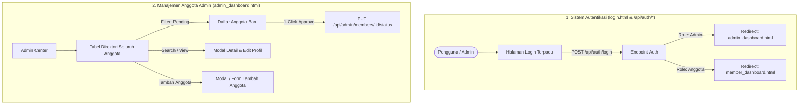

# Rencana Implementasi: Sistem Login (Autentikasi) & Manajemen Anggota Admin

Rencana ini merinci pembangunan sistem Autentikasi Login (Portal Anggota & Admin Center) serta perombakan menyeluruh pada Manajemen Anggota di Admin Dashboard untuk mengelola pendaftar baru (*Pending Verification*) dan memantau seluruh data anggota aktif.

---

## 1. Arsitektur & Alur Kerja

---

## 2. Proposed Changes

### A. Backend (`app.js`)

#### [MODIFY] [`app.js`](file:///d:/AI/APMA_WEB/app.js)
1. **Sistem Autentikasi & Sesi**:
   - `POST /api/auth/login`: Menerima `email` (atau `member_id_number`) dan `password`.
     - Memeriksa kredensial pada tabel `users_membership` (dengan verifikasi hashing `bcrypt`) serta fallback kredensial demo untuk Admin (`admin@apma.or.id` / `admin123`) dan Anggota (`budi@example.com` / `password123` atau `APMA-2026-0892`).
     - Mengembalikan data profil, peran (`Admin` / `Anggota`), status akun (`Active`, `Pending`, `Suspended`), dan token/sesi.
   - `GET /api/auth/me`: Mengambil status autentikasi pengguna yang sedang login.
   - `POST /api/auth/logout`: Membersihkan sesi autentikasi.

2. **Manajemen Anggota Lengkap untuk Admin**:
   - `GET /api/admin/members`: Mengambil daftar seluruh anggota (termasuk join dengan `member_profiles`) dengan dukungan filter `status` (`All`, `Pending`, `Active`, `Suspended`), pencarian teks `q` (nama, email, nomor anggota, perusahaan), dan pengurutan tanggal registrasi.
   - `GET /api/admin/members/:id`: Mengambil rincian data lengkap anggota tertentu.
   - `POST /api/admin/members`: Menambahkan anggota baru secara manual oleh Admin dengan penomoran otomatis `APMA-2026-XXXX`, password hashing `bcrypt`, tier, dan pemicu otomatisasi.
   - `PUT /api/admin/members/:id/status`: Mengubah status keanggotaan (misal: verifikasi aktivasi anggota baru dari `Pending` -> `Active`, atau menonaktifkan akun `Suspended`).
   - `PUT /api/admin/members/:id`: Memperbarui data profil dan keanggotaan anggota.
   - `DELETE /api/admin/members/:id`: Menghapus data anggota dari sistem.

---

### B. Frontend Pages

#### [NEW] [`login.html`](file:///d:/AI/APMA_WEB/login.html)
- Desain halaman login modern, elegan, dan profesional (*Dark Slate & Crimson Maroon Theme*).
- Tab pemilih peran: **Masuk Anggota (Member Portal)** vs **Masuk Administrator (Admin Center)**.
- Fitur *Quick Login / Demo Account Buttons* (1-klik langsung mengisi dan masuk sebagai Admin atau Anggota untuk kemudahan demo).
- Validasi form, toggle intip password (*Show/Hide Password*), dan pesan error interaktif.
- Redirection otomatis ke `admin_dashboard.html` atau `member_dashboard.html` setelah autentikasi sukses.

#### [MODIFY] [`admin_dashboard.html`](file:///d:/AI/APMA_WEB/admin_dashboard.html)
- Penambahan Section Utama: **"👥 Manajemen & Direktori Seluruh Anggota"**
  - **Filter Tab Dinamis**: *Semua Anggota*, *Menunggu Verifikasi (Pending)*, *Anggota Aktif*, *Dinonaktifkan (Suspended)*.
  - **Live Search Bar**: Pencarian instan berdasarkan Nama, Email, Nomor Anggota, atau Perusahaan.
  - **Tabel Data Anggota**: Menampilkan Nomor ID, Nama & Kontak, Perusahaan & Jabatan, Spesialisasi & Tier, Tanggal Registrasi, Badge Status Keanggotaan.
  - **Aksi Cepat Admin**:
    - Tombol **Verifikasi & Aktifkan** (1-klik untuk menyetujui pendaftar baru berstatus `Pending`).
    - Tombol **Detail & Edit Anggota** (Modal interaktif untuk memperbarui data).
    - Tombol **Nonaktifkan / Aktifkan Kembali (Suspend / Unsuspend)**.
    - Tombol **Hapus Anggota**.
  - **Modal Tambah Anggota Baru**: Formulir pop-up instan bagi admin untuk mendaftarkan anggota baru.
  - **Modal Detail & Edit Profil Anggota**: Pop-up untuk melihat portofolio lengkap dan mengedit data keanggotaan.
  - **Navigasi & Info Akun**: Indikator nama admin yang sedang login dan tombol **Logout** aman.

#### [MODIFY] [`index.html`](file:///d:/AI/APMA_WEB/index.html) & [`member_dashboard.html`](file:///d:/AI/APMA_WEB/member_dashboard.html)
- Memperbarui tombol navbar untuk mengarahkan ke `login.html` dan menambahkan tombol Logout dengan pembersihan sesi `localStorage`.

---

## 3. Rencana Verifikasi (Verification Plan)

### Automated & End-to-End Tests via Browser Subagent
1. **Tes Alur Login Anggota**:
   - Buka `http://localhost:3000/login.html`
   - Klik tombol demo / masukkan kredensial Anggota (`budi@example.com` / `password123`)
   - Verifikasi pengalihan sukses ke `member_dashboard.html` dengan nama Budi Santoso.
2. **Tes Alur Login Admin**:
   - Buka `http://localhost:3000/login.html`
   - Masukkan kredensial Admin (`admin@apma.or.id` / `admin123`)
   - Verifikasi pengalihan sukses ke `admin_dashboard.html`.
3. **Tes Manajemen Anggota di Admin Dashboard**:
   - Tinjau tabel seluruh data anggota.
   - Uji filter status (Semua, Pending, Active, Suspended) dan live search bar.
   - Tambah anggota baru berstatus `Pending` melalui modal pendaftaran.
   - Verifikasi pendaftar baru tersebut dan klik tombol **"Verifikasi & Aktifkan"**; pastikan status berubah menjadi `Active`.
   - Buka modal edit profil, ubah tier / spesialisasi, dan simpan.
   - Verifikasi perubahan tersimpan secara konsisten.
