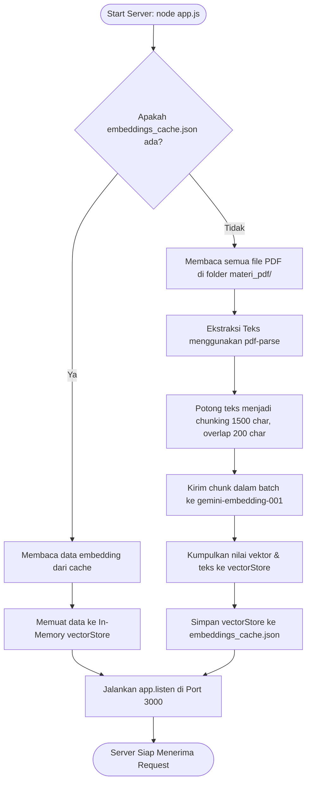
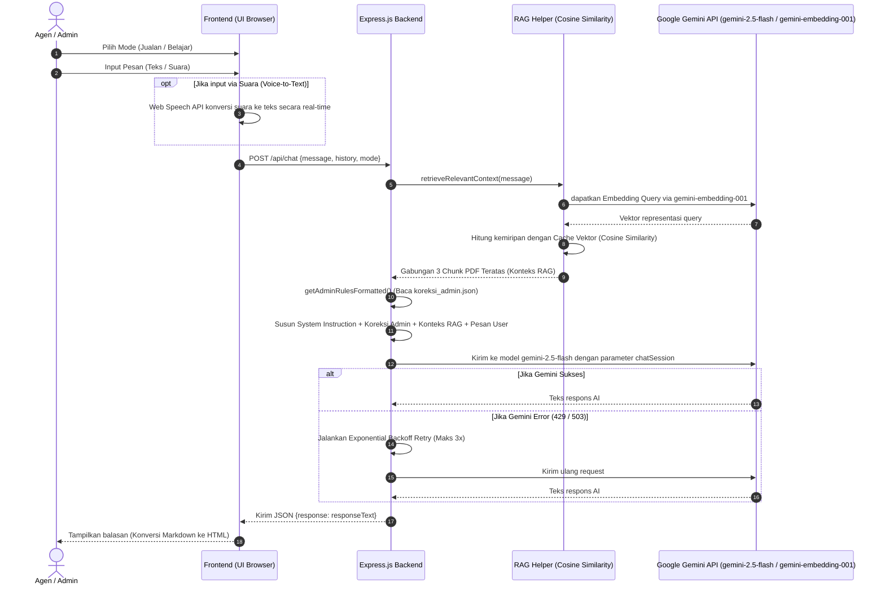
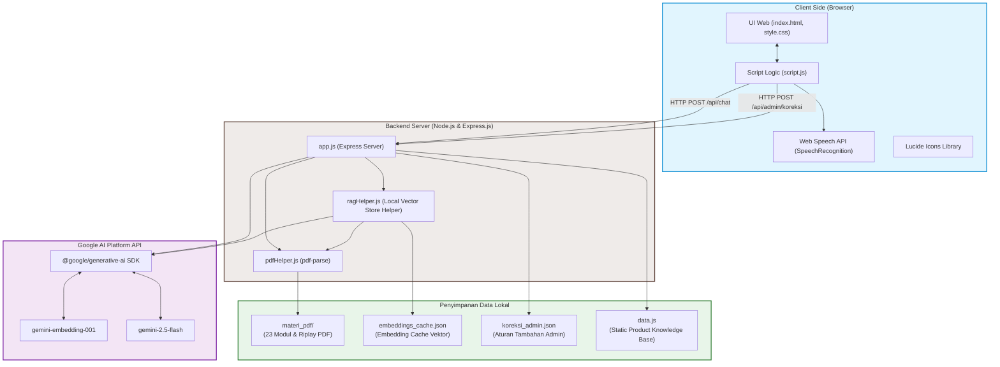

# Dokumen PRD, Alur (Flow), dan Arsitektur Terupdate: InsureMind AI

Dokumen ini menyajikan gambaran menyeluruh mengenai **InsureMind AI**, sebuah aplikasi chatbot asisten dan pelatih penjualan (Sales Coach) serta tutor persiapan ujian sertifikasi yang dirancang khusus untuk agen **Asuransi Sinar Mas**.

---

## 1. Product Requirement Document (PRD)

### 1.1 Analisis & Ringkasan Produk
* **Nama Produk**: InsureMind AI
* **Deskripsi**: Chatbot asisten agen asuransi berbasis kecerdasan buatan (Gemini 2.5 Flash & Gemini Embedding) yang terintegrasi dengan sistem RAG (Retrieval-Augmented Generation) berbasis PDF lokal dan basis pengetahuan produk.
* **Tujuan Utama**: 
  1. Membantu agen memahami teori produk asuransi umum, PAYDI (Unit Link), dan Surety Bond guna menghadapi ujian sertifikasi keagenan (Level 3 & 4) serta simulasi wawancara asesor.
  2. Memberikan pendampingan taktis penjualan secara proaktif (Sales Coaching), melakukan analisis profil risiko prospek, menawarkan rekomendasi cross-selling, dan memberikan draf pitching di lapangan.

### 1.2 Target Pengguna (User Persona)
1. **Agen Pemula & Menengah (Persiapan Sertifikasi Level 3/Ajun Ahli)**: Membutuhkan materi dasar, latihan kuis, dan penjelasan kasual tanpa dibingungkan oleh teknik jualan agresif.
2. **Agen Senior (Persiapan Sertifikasi Level 4/Ahli & Spesialisasi Bonding)**: Membutuhkan materi analisis keuangan kontraktor, reasuransi, manajemen kontra-jaminan, serta simulasi ujian wawancara lisan yang ketat.
3. **Agen Lapangan (Sales Agent)**: Membutuhkan strategi cross-selling, draf percakapan cepat (pitching template), serta analisis risiko calon nasabah secara instan.
4. **Admin / Supervisor**: Membutuhkan kontrol atas perilaku AI untuk menyesuaikan kebijakan baru atau memperbaiki kesalahan jawaban AI secara langsung tanpa menyentuh kode program.

### 1.3 Fitur Utama & Kebutuhan Fungsional (Core Features)

#### A. Dual Mode Chat (Context Isolation)
Untuk mencegah pencampuran perilaku (misalnya, AI tiba-tiba berjualan di tengah simulasi ujian belajar), chatbot menyediakan dua mode chat yang terisolasi secara ketat:
* **Mode Asisten Jualan (Sales Coach Mode)**:
  * Bersifat sangat **proaktif** dan interaktif.
  * Menerapkan taktik komunikasi "Ping-Pong" (tidak melakukan info-dumping/penjelasan terlalu panjang).
  * Memberikan analisis profil risiko prospek berdasarkan masukan agen.
  * Memberikan rekomendasi cross-selling produk komersial Asuransi Sinar Mas (seperti Simas Sehat Gold, Simas Sehat Executive, Simas Mobil, dsb.).
  * Menyertakan draf kalimat pembuka (*pitching template*) yang siap pakai.
  * Selalu diakhiri dengan pertanyaan pancingan untuk memicu diskusi lanjutan.
* **Mode Belajar & Ujian (Tutor Mode)**:
  * Bersifat **pasif-responsif** (hanya menjawab jika ditanya).
  * Menolak fungsi proaktif jualan. Dilarang keras menanyakan profil prospek komersial atau melakukan cross-selling.
  * Menyediakan modul bank soal dan kuis sertifikasi.
  * **Fitur Simulasi Ujian Lisan**: Jika dipicu dengan kata kunci "Latihan Ujian Lisan" atau "simulasi wawancara", AI berubah peran menjadi Penguji/Asesor yang tegas namun suportif. AI memberikan satu pertanyaan teknis sekali waktu dan menilai jawaban agen dengan format keluaran terstruktur:
    * `[PENILAIAN]`: Evaluasi status (TEPAT 🟢, KURANG TEPAT 🟡, SALAH 🔴) beserta skor numerik (misal: 85/100).
    * `[POIN POSITIF]`: Poin kelebihan dari jawaban agen.
    * `[KOREKSI & REVISI]`: Bedah kesalahan konsep secara detail.
    * `[SARAN JAWABAN EMAS]`: Draf jawaban sempurna untuk langsung dihafalkan agar auto-lulus.

#### B. RAG (Retrieval-Augmented Generation) berbasis PDF Lokal
* Mengidentifikasi dan mengekstrak materi dari **23 dokumen PDF** di folder `materi_pdf/` (berisi buku risiko & prinsip asuransi, aturan hukum keagenan, modul training, serta dokumen Ringkasan Informasi Produk dan Layanan [Riplay]).
* Memotong teks (*chunking*) dengan ukuran chunk 1500 karakter dan overlap 200 karakter.
* Membuat embeddings dengan model `gemini-embedding-001`.
* **Sistem Caching**: Menyimpan representasi vektor ke dalam `embeddings_cache.json` untuk menghindari pemanggilan API berulang pada saat server restart (menghemat kuota & waktu startup).
* Menggunakan algoritma pencarian Cosine Similarity lokal untuk mengambil 3 chunk teks (*top-k = 3*) paling relevan untuk diinjeksikan sebagai referensi kontekstual ke LLM.
* Memiliki guardrail instruksi agar AI tidak pernah menyebutkan frasa "berdasarkan dokumen PDF", "teks referensi", atau "dalam database", melainkan menjawab secara alami seolah-olah data tersebut adalah pengetahuan alaminya.

#### C. Input Suara (Voice-to-Text)
* Mengintegrasikan **Web Speech API** (`SpeechRecognition` / `webkitSpeechRecognition`) langsung pada browser client.
* Memungkinkan agen merekam suara (misalnya saat simulasi menjawab ujian lisan secara lisan) lalu secara otomatis mengonversinya menjadi teks di input chat.
* Menyediakan visual feedback yang dinamis (ikon mic menyala merah/animasi merekam) untuk menunjukkan status perekaman.

#### D. Portal Koreksi Mandiri Admin (Admin Feedback Loop)
* Menyediakan antarmuka modal bagi Admin untuk memasukkan instruksi tambahan atau koreksi perilaku AI (misal: *"Jangan tawarkan Simas Sehat Gold jika nasabah mencari perlindungan luar negeri"*).
* Menyimpan daftar koreksi ke dalam file `koreksi_admin.json`.
* Backend secara dinamis membaca file ini dan menggabungkannya ke dalam parameter `systemInstruction` API Gemini pada setiap sesi chat baru.

### 1.4 Guardrails & Sistem Keamanan AI
* **Isolasi Konteks**: Riwayat chat dikosongkan ketika user berpindah mode guna mencegah kebocoran context instruksi.
* **Filter Kebisingan Referensi**: RAG hanya menyisipkan referensi jika skor kemiripan relevan. Jika tidak relevan, backend akan mengabaikan RAG dan membiarkan LLM menggunakan base knowledge-nya.
* **Pelarangan Frasa Teknis**: AI dilarang keras membongkar rahasia dapur sistem (seperti *"Merujuk pada file PDF Anda..."*).
* **Penyebutan Brand**: AI diwajibkan menuliskan merek dagang secara lengkap menjadi **"Asuransi Sinar Mas"** (tidak boleh hanya "Sinar Mas").

### 1.5 Kebutuhan Non-Fungsional (Non-Functional Requirements)
* **Ketersediaan & Keandalan**: Mengimplementasikan mekanisme **Exponential Backoff Retry** (maksimal 3 kali percobaan) saat memanggil API Gemini untuk mengatasi error sementara seperti HTTP 429 (Too Many Requests) dan HTTP 503 (Service Unavailable).
* **Kecepatan Startup**: Startup server di bawah 5 detik jika cache embedding sudah terbentuk.
* **UI/UX Premium**: Desain antarmuka modern bernuansa futuristik dengan tipografi bersih (Google Font: Outfit), skema warna dark mode profesional, ikon dinamis dari Lucide Icons, dan tata letak responsif yang nyaman digunakan di perangkat desktop maupun mobile.

---

## 2. Alur Kerja Sistem (System Flows)

### 2.1 Alur Inisialisasi Server & Indeksasi RAG (Startup Flow)
Alur ini berjalan secara otomatis ketika server Express dijalankan pertama kali untuk memastikan data referensi PDF siap digunakan.

---

### 2.2 Alur Pemrosesan Pesan Chat (Chat Query Processing Flow)
Alur ini menggambarkan perjalanan request dari pengguna mengirim pesan hingga menerima balasan terformat dari AI.

---

## 3. Arsitektur Sistem Terupdate (System Architecture)

Aplikasi ini menggunakan arsitektur **3-Tier Monolith Ringkas** dengan integrasi API pihak ketiga (Google Gemini AI). Komponen data dan pemrosesan vektor diletakkan secara lokal di sisi server guna menekan kompleksitas infrastruktur.

### 3.1 Diagram Blok Arsitektur

---

### 3.2 Detail Komponen Arsitektur

#### 1. Presentation Layer (Frontend Browser)
* **index.html & style.css**: Membangun tampilan antarmuka modern dengan gaya *Glassmorphism*, sidebar intuitif untuk kontrol mode, badge status koneksi RAG, modal popup khusus admin, dan flexbox layout yang fully-responsive.
* **script.js**: Mengelola state obrolan (`chatHistory`, `currentMode`), melakukan manipulasi DOM, rendering parser markdown sederhana ke HTML, menangani pengiriman request fetch ke REST API backend, dan mengintegrasikan Web Speech API.
* **Web Speech API**: Beroperasi secara lokal di browser agen untuk menangkap input suara tanpa membutuhkan backend speech-to-text berbayar.

#### 2. Application Layer (Backend Server)
* **app.js (Express.js Server)**:
  * Berfungsi sebagai API Gateway lokal.
  * Menyediakan endpoint `/api/chat` untuk pemrosesan pesan chat dan `/api/admin/koreksi` untuk penyimpanan koreksi dinamis admin.
  * Mengintegrasikan `@google/generative-ai` SDK untuk berkomunikasi dengan model Gemini.
  * Menyimpan sistem instruksi dasar (*Belajar* & *Jualan*) dan aturan guardrails.
  * Menyediakan middleware statis untuk menyajikan file frontend.
* **ragHelper.js**:
  * Mengelola siklus pembuatan embeddings teks.
  * Melakukan pencarian relevansi teks berbasis Cosine Similarity secara manual pada array in-memory.
* **pdfHelper.js**:
  * Menyediakan utility pembacaan data biner PDF dan ekstraksi string menggunakan parser `pdf-parse`.

#### 3. Data & Storage Layer (Local Filesystem)
* **materi_pdf/**: Direktori penyimpanan dokumen referensi mentah (PDF).
* **embeddings_cache.json**: File JSON berisi data text chunk yang dipetakan langsung dengan array float embedding-nya (hasil keluaran model `gemini-embedding-001`). Berperan sebagai database vektor lokal yang hemat biaya.
* **koreksi_admin.json**: File JSON penyimpan catatan revisi dari admin. Dibaca setiap kali user mengirim pesan baru untuk digabungkan ke system instruction secara *real-time*.
* **data.js**: File modul JavaScript penampung konstanta `ASURANSI_KNOWLEDGE_BASE` yang berisi produk asuransi internal terstruktur (seperti Simas Sehat Gold, Simas Mobil, detail sertifikasi Level 3 dan Level 4, dsb.).

#### 4. Cognitive & AI Services (External Cloud)
* **Google Gemini Platform**:
  * **gemini-embedding-001**: Digunakan untuk mengubah representasi query pencarian dan chunk teks dokumen menjadi koordinat vektor 768-dimensi.
  * **gemini-2.5-flash**: Model bahasa utama yang cepat, berkapasitas token besar, dan andal untuk memproses dialog, menganalisis jawaban ujian lisan, serta merekomendasikan strategi pemasaran.

---

### 3.3 Ringkasan Technology Stack
| Layer | Teknologi / Library | Keterangan |
| :--- | :--- | :--- |
| **Frontend UI** | HTML5, CSS3, Google Fonts (Outfit), Lucide Icons | Antarmuka modern, responsif, & premium |
| **Voice Engine** | Web Speech API (`SpeechRecognition`) | Voice-to-Text lokal pada browser client |
| **Backend Engine** | Node.js, Express.js | Server aplikasi dan API endpoint |
| **PDF Extraction** | `pdf-parse` | Ekstraksi asinkron teks dari dokumen PDF lokal |
| **AI LLM API** | `@google/generative-ai` SDK | SDK integrasi AI Google |
| **Model Chat** | `gemini-2.5-flash` | Pemrosesan logika, kuis, & sales coaching |
| **Model RAG** | `gemini-embedding-001` | Pembuatan representasi vektor teks |
| **Database Vektor** | Custom In-Memory Vector Store + Local Cache | Pencarian berbasis Cosine Similarity lokal |
| **Konfigurasi** | `dotenv`, `cors`, `fs`, `path` | Manajemen lingkungan, CORS, dan filesystem |
