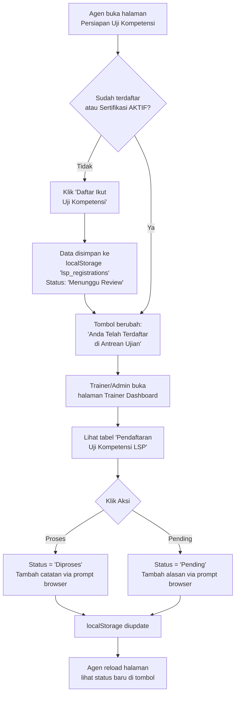

# Audit: Flow Pendaftaran Ujian Resmi LSP

## Flow Yang Sudah Ada

## Bug & Masalah Yang Ditemukan

### 🔴 Bug Kritis

| No | Masalah | Dampak |
|----|---------|--------|
| 1 | **Agen AGN-001 hardcoded `sertifikasi: 'AKTIF'`** di data demo, sehingga tombol selalu disabled meski belum pernah daftar | Agen tidak bisa mendaftar sama sekali |
| 2 | **`updateLspRegistrationStatus` menggunakan `prompt()` browser** yang sering diblokir browser modern | Trainer tidak bisa update status |
| 3 | **`alert()` digunakan setelah update status** — diblokir di beberapa browser | Tidak ada konfirmasi ke Trainer |
| 4 | **Tabel trainer tidak auto-refresh** — Trainer harus refresh halaman manual untuk lihat pendaftar baru | Status tidak real-time |

### 🟡 Masalah UX

| No | Masalah | Dampak |
|----|---------|--------|
| 5 | Agen tidak bisa lihat **riwayat/detail** pendaftarannya (tanggal daftar, skema dipilih) | Informasi minim untuk agen |
| 6 | Status "Diproses" dan "Pending" tampilannya mirip — perlu ikon lebih jelas | Membingungkan |
| 7 | **Tidak ada notifikasi** ke agen saat Trainer mengubah status | Agen harus reload manual |
| 8 | Input skema kualifikasi (dropdown `select-qualification-type`) tidak ada di halaman sertifikasi | Data skema tidak tersimpan dengan benar |

## Open Questions

> [!IMPORTANT]
> Apakah status yang perlu ada cukup 3 ini, atau perlu ditambah?
> - **Menunggu Review** → baru daftar
> - **Diproses** → disetujui, sedang diurus ke LSP  
> - **Pending** → dikembalikan, ada kekurangan syarat
> - (Tambahan?) **Dijadwalkan** → sudah ada tanggal ujian
> - (Tambahan?) **Lulus / Tidak Lulus** → hasil akhir ujian

## Rencana Perbaikan

1. ✅ Fix hardcoded `sertifikasi: 'AKTIF'` — gunakan `lsp_registrations` saja sebagai acuan
2. ✅ Ganti `prompt()` → modal form custom untuk input catatan Trainer
3. ✅ Ganti `alert()` → `showToast()` notifikasi
4. ✅ Tambah panel status di sisi agen (tanggal daftar, skema, catatan trainer, status badge berwarna)
5. ✅ Auto-refresh tabel trainer setiap navigasi ke halaman trainer
6. ✅ Tambah tombol **"Batalkan Pendaftaran"** untuk agen yang ingin cancel
