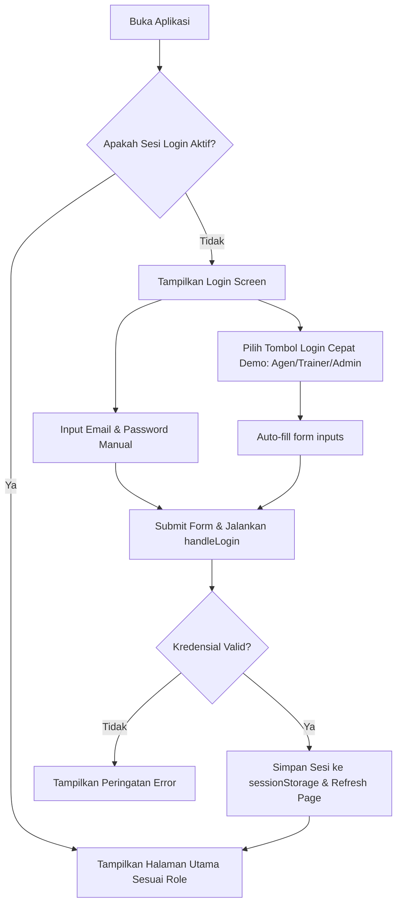
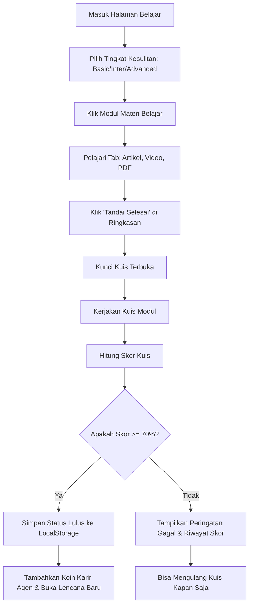
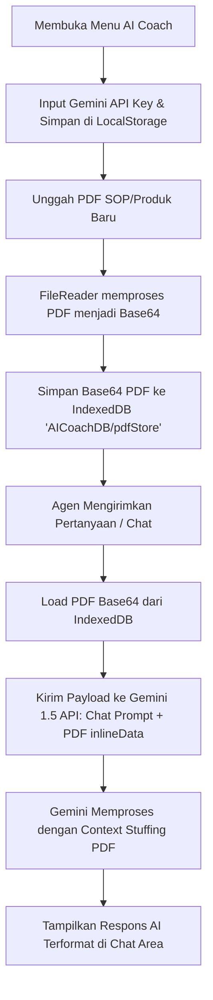
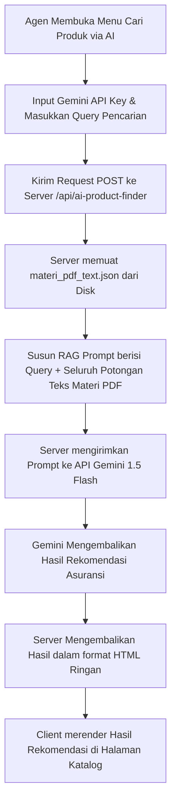
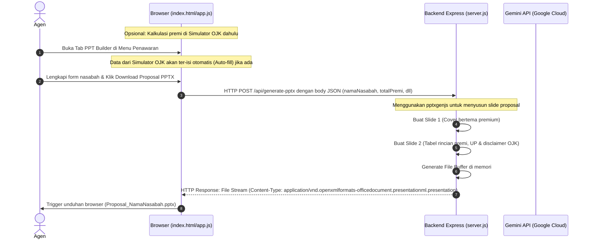
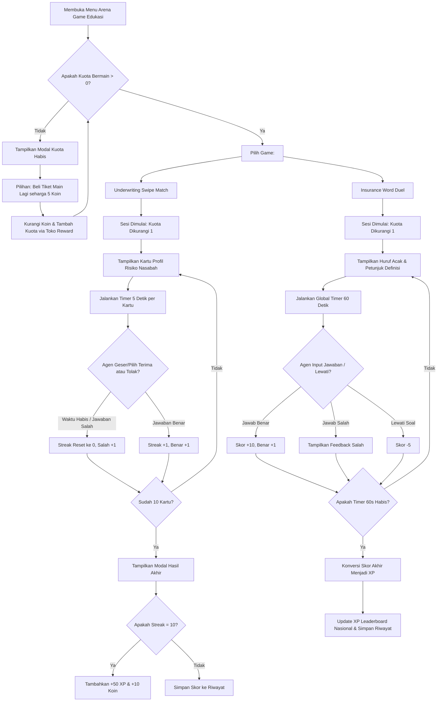

# Dokumen Sistem: InsureMind Agent Platform (ASM Academy)
Dokumen ini menyajikan **Product Requirements Document (PRD)**, **Sistem Flow (Alur Kerja)**, **Arsitektur Aplikasi**, dan **Teknikal Desain** dari sistem yang telah diimplementasikan hingga saat ini.

---

## 1. Product Requirements Document (PRD)

### 1.1 Latar Belakang & Tujuan
**InsureMind Agent Platform** (dikenal juga sebagai **ASM Academy**) adalah platform berbasis web (Single Page Application) terintegrasi yang dirancang untuk meningkatkan kompetensi, kepatuhan hukum, dan efektivitas penjualan agen asuransi umum di Indonesia. 

Tujuan utama sistem ini adalah:
* **Gamifikasi Pelatihan**: Menyediakan platform Learning Management System (LMS) mandiri dengan penghargaan koin karir, peringkat (leaderboard), dan lencana pencapaian.
* **Sertifikasi LSP**: Memanfasilitasi pendaftaran sertifikasi lembaga sertifikasi profesi (LSP) dan latihan ujian (tryout) secara digital.
* **Pendamping Kerja AI (AI Coach)**: Membantu agen menemukan produk asuransi yang tepat secara instan menggunakan teknologi RAG (Retrieval-Augmented Generation).
* **Otomatisasi Penawaran (PPT Builder)**: Mempercepat proses pembuatan proposal presentasi formal yang mematuhi regulasi tarif premi OJK secara dinamis.

### 1.2 Target Pengguna & Peran (Roles)
Platform ini memiliki arsitektur multi-peran dengan fitur-fitur yang disesuaikan untuk masing-masing peran:

| Peran (Role) | Deskripsi | Fitur Utama dalam Sistem |
| :--- | :--- | :--- |
| **Agen (Agent)** | Pengguna akhir yang menjual produk asuransi. | Mengikuti materi pelatihan LMS, kuis, pendaftaran kelas live training (RSVP), mencoba simulasi ujian LSP, kalkulator premi OJK, AI Coach (pencarian produk), pembuatan proposal PPTX, dan penukaran koin di Toko Reward. |
| **Trainer** | Pengajar/fasilitator kompetensi. | Manajemen kelas live training, pembuatan token kehadiran, publikasi kuis training, verifikasi kelulusan agen, dan penerbitan sertifikat pelatihan resmi. |
| **Admin** | Pengelola sistem dan operasional. | Manajemen katalog produk asuransi dinamis (FAQ, link brosur), manajemen barang toko reward (stok voucher fisik & virtual), pengelolaan akun pengguna, pemantauan log transaksi sistem, dan persetujuan klaim hadiah agen. |
| **Pimpinan (Management)** | Pemantau kinerja tingkat tinggi. | Dashboard monitoring total produksi agen, grafik performa bulanan, pemantauan status kelulusan sertifikasi agen, laporan penyerapan reward, serta leaderboard nasional & regional. |

### 1.3 Ruang Lingkup Fitur (Feature Scope)
1. **Modul LMS Mandiri (Gamified Learning)**:
   * Pembagian materi belajar dalam 3 level tingkat kesulitan: **Basic**, **Intermediate**, dan **Advanced**.
   * Format pembelajaran multimedia terstruktur (Tab: Artikel, Video, PDF Buku Rujukan, Ringkasan, dan Kuis Evaluasi).
   * Pelacakan kemajuan/progres belajar per modul dengan sistem "Selesai dibaca".
   * Kuis modul dengan penilaian dinamis (lulus jika skor >= 70%) untuk mendapatkan koin karir.
2. **Sertifikasi LSP & Tryout**:
   * Pendaftaran tryout ujian sertifikasi profesi keagenan asuransi.
   * Player ujian interaktif dengan pengatur waktu dan analisis skor riwayat tryout.
   * Tampilan lencana sertifikat dinamis ("Certified") pada profil agen yang lolos sertifikasi.
3. **Sesi Live Training (LMS Kelas)**:
   * Halaman RSVP live training untuk mendaftar kelas virtual/tatap muka.
   * Validasi kehadiran real-time menggunakan Token Absensi (4 digit angka) yang diterbitkan oleh Trainer kelas.
   * Penerbitan dan pengunduhan sertifikat kelas pelatihan berformat digital jika lulus kuis khusus pasca-training.
4. **Toko Reward Virtual (Gamification Store)**:
   * Penukaran koin agen yang didapatkan dari kuis dengan item premium.
   * Item berupa voucher virtual (pulsa, e-wallet) yang terproses otomatis, voucher fisik (menunggu persetujuan admin), atau item kosmetik profil (Bingkai Emas Premium).
5. **AI Insurance Coach & Product Finder (RAG)**:
   * Chatbot AI lokal maupun terintegrasi dengan Google Gemini 1.5 Flash.
   * *Client-side RAG*: Pengguna dapat mengunggah file PDF pendukung, menyimpannya di IndexedDB browser, dan menyertakannya sebagai konteks chat langsung.
   * *Server-side RAG*: Fitur pencarian produk berbasis data SOP internal dari file [materi_pdf_text.json](file:///d:/AI/Antigravity/materi_pdf_text.json).
6. **Auto Proposal PPTX Builder & Simulator**:
   * Kalkulator Premi untuk produk asuransi Kendaraan Bermotor (Comprehensive & TLO) dan Kebakaran/Properti berdasarkan tarif resmi OJK (SE OJK No. 6/SEOJK.05/2017).
   * PPTX Generator server-side menggunakan pustaka `pptxgenjs` yang terintegrasi dengan form input agen untuk menghasilkan presentasi PowerPoint siap unduh yang berisi ringkasan manfaat dan disclaimer hukum kepatuhan asuransi.
7. **Arena Game Edukasi (Mini-Games)**:
   * **Underwriting Swipe Match**: Game simulasi seleksi risiko ("Tinder-style") di mana agen memutuskan untuk menerima (geser kanan) atau menolak (geser kiri) profil calon nasabah berdasarkan kesesuaian underwriting dalam batas waktu 5 detik per kartu. Hadiah berupa +50 XP & +10 Koin per 10 streak.
   * **Insurance Word Duel**: Game susun kata berdurasi time-attack 60 detik untuk menyusun istilah-istilah asuransi yang diacak hurufnya (word scramble) berdasarkan definisi/petunjuk. Skor yang diraih akan langsung dikonversi menjadi XP.
   * **Sistem Tiket & Kuota Bermain**: Agen dibatasi kuota bermain gratis sebanyak 2 sesi per hari. Agen dapat menambah tiket bermain dengan membelinya seharga 5 Koin di Toko Reward.

---

## 2. Alur Sistem (System Flow)

Bagian ini menggambarkan diagram alur operasional utama di dalam platform.

### 2.1 Alur Autentikasi & Login Cepat (Bypass)
Sistem ini menggunakan mekanisme login bypass agresif untuk demo demi memudahkan pergantian peran (Agen, Trainer, Admin).



### 2.2 Alur Evaluasi Materi LMS & Gamifikasi Koin
Alur ini menjelaskan bagaimana agen mempelajari materi LMS dan memperoleh koin.



### 2.3 Alur Asisten AI Coach & RAG (Retrieval-Augmented Generation)
Sistem memiliki dua alur asisten AI berbasis RAG: **Client-Side PDF Upload** dan **Server-Side AI Product Finder**.

#### A. Client-Side RAG (IndexedDB & Gemini API)


#### B. Server-Side RAG (AI Product Finder)


### 2.4 Alur Pembuatan Proposal & Unduh PPTX
Mekanisme integrasi form quotation dengan backend generator PPTX.



### 2.5 Alur Arena Game Edukasi (Mini-Games)
Alur ini menjelaskan alur operasional pemilihan game, pengecekan kuota harian, serta siklus permainan pada Swipe Match dan Word Duel.



---

## 3. Arsitektur Sistem (System Architecture)

### 3.1 Gambaran Umum Arsitektur
Sistem ini menggunakan arsitektur **Client-Server terpisah (Decoupled Architecture)** dengan Single Page Application (SPA) pada sisi klien dan Express API Server pada sisi server.

```
       +--------------------------------------------------------+
       |                  CLIENT WEB BROWSER                     |
       |  +--------------------------------------------------+  |
       |  |                    UI/UX Layer                   |  |
       |  |  (index.html, asm-style.css, Vanilla CSS Grid)    |  |
       |  +--------------------------------------------------+  |
       |  |                 Controller Layer                 |  |
       |  |      (app.js, ai-coach.js, canvas-confetti)      |  |
       |  +-------------------------------------+------------+  |
       |  |          State & Storage Layer      |            |  |
       |  |  (LocalStorage)                     | (IndexedDB)|  |
       |  +---------+---------------------------+------+-----+  |
       +------------|----------------------------------|--------+
                    |                                  |
                    | (Request API Server)             | (Direct API Key Call)
                    v                                  v
       +------------+------------+           +---------+---------+
       |   BACKEND API SERVER    |           |   GOOGLE GEMINI   |
       |       (server.js)       |           |    1.5 FLASH      |
       |  +-------------------+  |           |   CLOUD API       |
       |  +-------------------+  |                     ^
       |  |  Express Engine   |  |           +-------------------+
       |  +-------------------+  |                     | (RAG API Call)
       |  |    pptxgenjs      |  |                     |
       |  +-------------------+  |                     |
       |  |  materi_pdf_text  |  +---------------------+
       |  |      (.json)      |  |
       |  +-------------------+  |
       +-------------------------+
```

### 3.2 Teknologi yang Digunakan
1. **Frontend**:
   * **HTML5**: Struktur halaman SPA menggunakan sistem section display toggle (`display: none` / `display: block`).
   * **Vanilla CSS (asm-style.css)**: Sistem desain modern bertema gelap/navy premium, tata letak menggunakan Flexbox dan CSS Grid, efek visual glassmorphism, lencana transparan, transisi hover, dan responsivitas seluler.
   * **Vanilla Javascript**: Manajemen logika aplikasi tanpa framework (React/Vue/Angular) untuk mempertahankan kecepatan rendering, pembersihan memori, dan kemudahan debug.
   * **IndexedDB**: Database lokal di peramban untuk menyimpan file PDF berukuran besar (penyimpanan biner/base64) secara lokal.
   * **LocalStorage**: Penyimpanan persisten untuk state data dinamis (progres belajar, kuis, data toko reward).
2. **Backend**:
   * **Node.js**: Runtime Javascript sisi server.
   * **Express.js**: Kerangka kerja API server minimalis untuk mendefinisikan rute dan middleware CORS.
   * **PptxGenJS**: Pustaka manipulasi dokumen presentasi untuk menyusun slide presentasi PowerPoint secara dinamis dari server.
3. **AI Core**:
   * **Gemini 1.5 Flash API**: Model kecerdasan buatan dari Google yang digunakan untuk menganalisis query pengguna dengan mengintegrasikan data RAG (baik PDF lokal dari browser maupun JSON dari database backend).

---

## 4. Teknikal Desain (Technical Design)

### 4.1 Struktur File & Folder Proyek

```
d:\AI\Antigravity\
├── server.js               # Backend API Server (Express.js, pptxgenjs, RAG endpoint)
├── app.js                  # Logika pengendali frontend utama (LMS, Ujian, Kuis, Toko Reward, Router SPA)
├── ai-coach.js             # Logika asisten AI Coach sisi klien (IndexedDB & Direct Gemini API integration)
├── data.js                 # Dataset default frontend (Materi LMS, Tryout, Reward, dan Akun Demo)
├── index.html              # Struktur UI tunggal aplikasi SPA (Tampilan Agen, Trainer, Admin, Pimpinan)
├── asm-style.css           # Lembar gaya (CSS) utama bertema premium modern (Navy/Light Blue)
├── style.css               # Lembar gaya alternatif/tambahan
├── check_shell.js          # Skrip pembantu pengecekan integritas DOM shell HTML
├── fix_app.py              # Skrip otomasi untuk memperbarui logika training kuis di app.js
├── materi_pdf_text.json    # Dataset teks RAG server-side (Hasil ekstraksi dokumen asuransi)
├── materi_pdf_text.js      # Refleksi dataset teks RAG ke format variabel javascript
└── materi_pdf/             # Direktori penyimpanan fisik dokumen PDF SOP internal perusahaaan
```

### 4.2 Skema Data (Data Model) & Persistensi
Aplikasi ini berjalan tanpa database SQL tradisional di tingkat frontend (berbasis client-side mock-db), tetapi menyimpan perubahan data pada LocalStorage dan IndexedDB.

#### A. Kunci LocalStorage Utama
1. `pa_materials`: Menyimpan data pembelajaran LMS dinamis. Jika belum pernah diubah oleh Trainer/Admin, sistem akan memuat data bawaan dari `STUDY_MATERIALS_DEFAULT` di [data.js](file:///d:/AI/Antigravity/data.js).
2. `pa_agent_module_progress`: Format objek penyimpan progres belajar modul asuransi per agen.
   ```json
   {
     "rian.aditya@asm-academy.id": {
       "dasar-asuransi": { "readDone": true, "quizPassed": true, "bestScore": 100, "attempts": 1 }
     }
   }
   ```
3. `pa_trainings`: Menyimpan agenda training kelas yang dibuat oleh Trainer.
4. `pa_training_attendance`: Menyimpan riwayat RSVP dan kehadiran token agen.
   ```json
   {
     "rian.aditya@asm-academy.id": {
       "class-id-101": { "status": "Hadir", "attendedAt": 1782542400000 }
     }
   }
   ```
5. `pa_reward_claims`: Log data transaksi klaim penukaran koin agen.
   ```json
   [
     {
       "id": "claim-1782542400123",
       "userEmail": "rian.aditya@asm-academy.id",
       "userName": "Rian Aditya",
       "rewardId": "voucher-gopay-50",
       "rewardTitle": "Voucher Gopay Rp 50.000",
       "pointsCost": 50,
       "claimedAt": "27 Juni 2026",
       "status": "Selesai",
       "voucherCode": "GP-MOCK-992123"
     }
   ]
   ```
6. `gemini_api_key`: Kunci otorisasi Gemini API miliki pengguna yang disimpan lokal demi privasi.
7. `pa_game_quota`: Menyimpan sisa kuota bermain harian agen (default: 2 per hari).
8. `pa_game_history`: Menyimpan riwayat bermain game edukasi (tanggal, tipe game, skor, streak, koin/XP diperoleh).

#### B. Skema IndexedDB (AICoachDB)
* **Object Store**: `pdfStore`
* **Key**: `knowledge_pdf` (menyimpan file tunggal PDF yang diunggah oleh Trainer/Admin dalam format biner Base64 untuk disematkan dalam prompt Gemini).

### 4.3 Detail Endpoint API Backend (`server.js`)

#### 1. Health Check
* **Endpoint**: `GET /api/health`
* **Deskripsi**: Verifikasi status backend server.
* **Response**:
  ```json
   {
     "status": "ok",
     "message": "InsureMind Agent Backend Running ✅",
     "timestamp": "2026-06-27T12:00:00.000Z"
   }
  ```

#### 2. Generate PPTX Proposal
* **Endpoint**: `POST /api/generate-pptx`
* **Deskripsi**: Membuat file presentasi proposal PowerPoint profesional berdasarkan data quotation agen secara real-time di server.
* **Request Header**: `Content-Type: application/json`
* **Request Body**:
  ```json
   {
     "namaNasabah": "Budi Santoso",
     "namaAgen": "Rian Aditya",
     "jenisAsuransi": "ASM Auto Protection (Comprehensive)",
     "totalPremi": 4500000,
     "nilaiPertanggungan": 200000000,
     "catatanTambahan": "Diskon promosi kuartal ke-2 sebesar 10% sudah termasuk."
   }
  ```
* **Response**: Berkas presentasi PowerPoint `.pptx` biner (MIME Type: `application/vnd.openxmlformats-officedocument.presentationml.presentation`).

#### 3. AI Product Finder (RAG)
* **Endpoint**: `POST /api/ai-product-finder`
* **Deskripsi**: Mencari dan mencocokkan produk asuransi Sinar Mas berdasarkan pertanyaan agen menggunakan Gemini API 1.5 Flash dan basis data PDF lokal server.
* **Request Header**:
  * `Content-Type: application/json`
  * `Authorization: Bearer <GEMINI_API_KEY>`
* **Request Body**:
  ```json
   {
     "query": "Nasabah ingin asuransi mobil all risk yang juga menutupi risiko gempa bumi dan banjir. Apa produknya?"
   }
  ```
* **Response**:
  ```json
   {
     "result": "<h4>🎯 Produk yang Direkomendasikan:</h4><ul><li><strong>ASM Auto Protection (Comprehensive)</strong>...</li></ul>"
   }
  ```

---

> [!IMPORTANT]
> **Integrasi Frontend Selesai**: Fitur **Auto Proposal PPTX Builder** telah diintegrasikan sepenuhnya secara fungsional di sisi klien ([app.js](file:///d:/AI/Antigravity/app.js)). Klien sekarang secara otomatis memicu permintaan HTTP POST ke server `/api/generate-pptx` dengan payload data formulir quotation, menangani unduhan file `.pptx` hasil generate, memperbarui preview slide secara real-time, serta memantau status koneksi backend server secara dinamis melalui `/api/health`.
