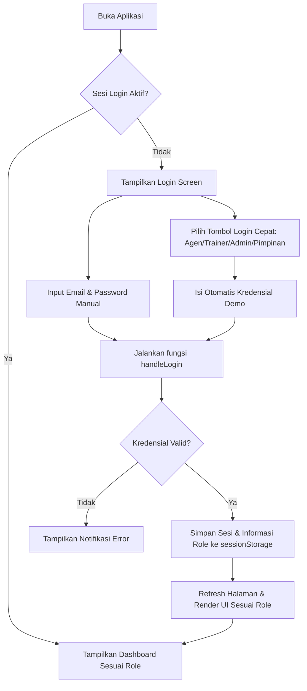
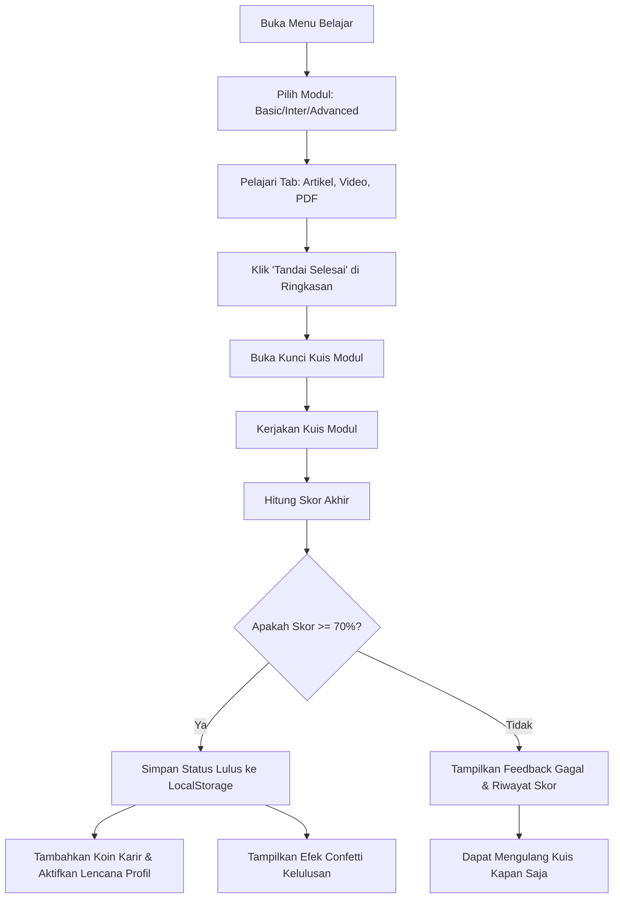
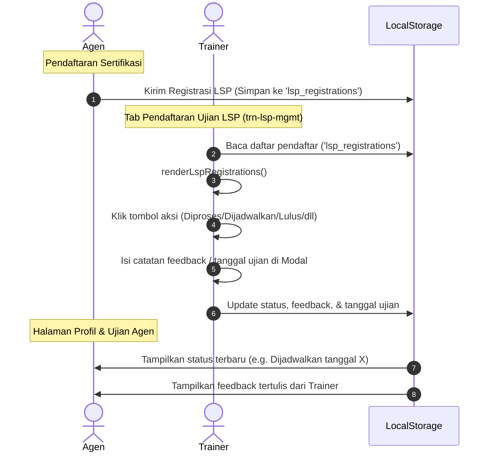
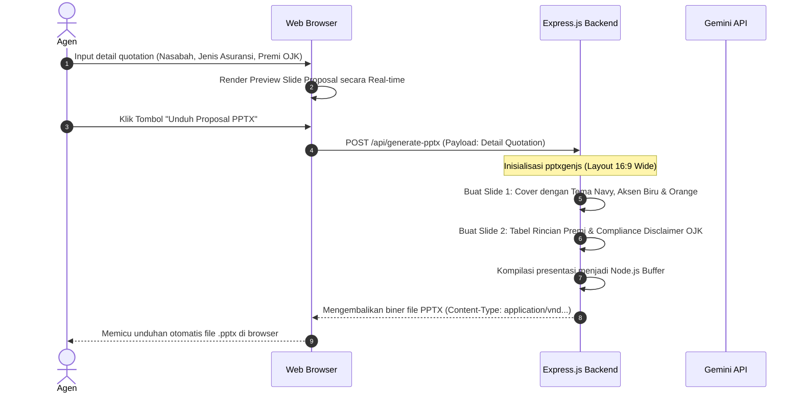

# 📝 Dokumen Sistem Terupdate: PRD, Alur (Flow), & Arsitektur
## **InsureMind AI — Sinar Mas Sales Coach (ASM Academy)**

Dokumen ini menyajikan spesifikasi produk, alur logika, dan arsitektur teknis terupdate dari platform **InsureMind AI (ASM Academy)**. Sistem dirancang untuk mendukung pelatihan agen asuransi secara gamified, persiapan sertifikasi LSP, pendampingan kerja berbasis AI, dan pembuatan proposal otomatis (PPT Builder) sesuai regulasi OJK.

---

## 🎯 1. Product Requirements Document (PRD)

### 1.1 Latar Belakang & Visi Produk
Agen asuransi umum di Indonesia menghadapi tiga tantangan utama:
1. **Kompetensi Produk**: Memahami detail produk asuransi harta benda, kendaraan bermotor, dan kesehatan secara akurat.
2. **Kepatuhan Regulasi (Compliance)**: Mematuhi batas tarif premi resmi yang ditetapkan OJK (Surat Edaran OJK No. 6/SEOJK.05/2017).
3. **Efisiensi Penjualan**: Waktu yang lama untuk membuat proposal penawaran (quotation) resmi bagi calon nasabah.

**InsureMind AI (ASM Academy)** hadir sebagai **Single Page Application (SPA)** terintegrasi untuk menyelesaikan masalah tersebut dengan menggabungkan **Gamified LMS, Asisten AI RAG (Retrieval-Augmented Generation), dan Auto Proposal PPTX Generator**.

### 1.2 Profil Pengguna & Hak Akses (User Personas)

 Sesuai pembaruan sistem terbaru, platform mengadopsi 4 peran pengguna dengan fungsionalitas khusus:

| Peran (Role) | Deskripsi | Cakupan Akses & Fitur Utama |
| :--- | :--- | :--- |
| **Agen (Agent)** | Pengguna akhir di lapangan yang melakukan penjualan. | - Mengikuti modul pembelajaran mandiri (LMS).<br>- Mengerjakan kuis kualifikasi untuk koin karir.<br>- Melakukan RSVP kelas pelatihan langsung (Live Training).<br>- Mengikuti latihan tryout sertifikasi LSP & mendaftar ujian.<br>- Menggunakan Simulator Premi OJK & mengunduh proposal PPTX.<br>- Bertanya ke AI Coach & menukarkan koin di Toko Reward. |
| **Trainer** | Fasilitator/Pengajar kompetensi keagenan. | - Mengelola sesi pelatihan langsung (Live Training).<br>- Menerbitkan Token Absensi kelas (4 digit).<br>- Menyetujui kelulusan & menerbitkan sertifikat pelatihan.<br>- **(Terupdate)** Mengelola pendaftaran sertifikasi LSP agen (menyetujui, menjadwalkan, memberi feedback hasil ujian). |
| **Admin** | Pengelola data operasional dan katalog sistem. | - Mengelola katalog produk asuransi (FAQ, brosur).<br>- Mengelola daftar item & stok di Toko Reward.<br>- Menyetujui/memproses klaim hadiah fisik agen.<br>- Memantau aktivitas umum sistem. |
| **Pimpinan (Management)** | Pemegang kebijakan & supervisor kinerja keagenan. | - Melihat Dashboard Analitik Performa Nasional.<br>- Memantau total produksi premi agen.<br>- Memantau rasio kelulusan sertifikasi LSP & pelatihan.<br>- Melihat peringkat (Leaderboard) agen secara real-time. |

---

### 1.3 Spesifikasi Fitur Fungsional (Feature Specifications)

#### **1. Gamified LMS (Learning Management System)**
* **Spesifikasi**: Materi dibagi menjadi 3 kategori (Basic, Intermediate, Advanced). Setiap modul dilengkapi dengan tab: Artikel, Video, PDF Referensi, dan Ringkasan.
* **Mekanisme Kelulusan**: Agen harus menyelesaikan materi dan menjawab Kuis Modul dengan nilai $\ge 70\%$.
* **Sistem Hadiah**: Kelulusan memberikan koin karir (Basic: 10 koin, Intermediate: 20 koin, Advanced: 30 koin) dan membuka lencana prestasi (Badge) secara otomatis.

#### **2. Sertifikasi LSP & Manajemen Tryout**
* **Spesifikasi**: Agen dapat berlatih soal ujian lisensi resmi melalui simulator Tryout LSP dengan batasan waktu (timer).
* **Pendaftaran LSP**: Agen dapat mendaftar sertifikasi resmi langsung dari aplikasi.
* **(Terupdate) Portal Persetujuan Trainer**: Trainer memiliki tab khusus (`trn-lsp-mgmt`) untuk memperbarui status pendaftaran LSP agen menjadi *Diproses*, *Pending*, *Dijadwalkan* (dengan tanggal ujian), *Lulus*, atau *Tidak Lulus* lengkap dengan umpan balik (feedback) tertulis.

#### **3. Live Training (Kelas LMS Terintegrasi)**
* **Spesifikasi**: Sesi kelas virtual terjadwal.
* **Absensi Presisi**: Agen melakukan RSVP, lalu wajib memasukkan 4-digit token absensi dinamis yang dibuat oleh Trainer saat kelas berlangsung untuk verifikasi kehadiran.
* **Kelulusan Kelas**: Trainer memverifikasi nilai kuis kelas agen untuk menerbitkan sertifikat digital resmi yang dapat diunduh agen.

#### **4. Toko Reward Virtual (Virtual Gift Shop)**
* **Spesifikasi**: Penukaran koin karir dengan hadiah.
* **Otomatisasi**: Hadiah e-voucher (E-Wallet, Pulsa) diproses instan melalui trigger API / Local Mock. Hadiah fisik memerlukan persetujuan Admin di panel Admin.
* **Item Kosmetik**: Agen dapat membeli bingkai profil emas premium (Gold Border) yang secara dinamis memperbarui visual avatar mereka.

#### **5. AI Insurance Coach & Product Finder (RAG)**
* **RAG Client-Side (Fleksibilitas Agen/Trainer)**: Pengguna dapat mengunggah file PDF SOP atau panduan produk baru. Berkas diubah menjadi Base64, disimpan secara lokal di IndexedDB (`AICoachDB`), dan disematkan langsung sebagai `inlineData` dalam payload API Gemini 1.5 Flash untuk konsultasi instan tanpa overhead server.
* **RAG Server-Side (Standardisasi Perusahaan)**: Fitur "AI Product Finder" di mana backend Express memuat seluruh database pengetahuan dari `materi_pdf_text.json` dan menyajikannya sebagai basis konteks RAG ketika agen mencari produk Sinar Mas yang sesuai lewat endpoint `/api/ai-product-finder`.

#### **6. Auto Proposal PPTX Builder & Simulator**
* **Simulator Kalkulator OJK**: Perhitungan premi motor komprehensif/TLO dan properti (Industrial All Risks / Flexas) berdasarkan tarif resmi wilayah OJK.
* **Integrasi PPTX**: Data perhitungan premi dikirim ke backend Node.js untuk dikompilasi secara real-time menggunakan pustaka `pptxgenjs` menjadi presentasi PowerPoint 16:9 yang estetis (2 slide utama: Cover Proposal Elegan & Tabel Rincian Premi beserta Compliance Disclaimer resmi).

---

## 🔄 2. Alur Sistem (System Flows)

Berikut adalah diagram alur kerja terupdate dari fungsi-fungsi kunci di dalam sistem:

### 2.1 Alur Autentikasi & Multi-Role Toggle (Demo Mode)


### 2.2 Alur Modul LMS & Akumulasi Koin Karir


### 2.3 Alur Pendaftaran & Validasi Sertifikasi LSP (Terupdate)


### 2.4 Alur AI Insurance Coach (RAG Client & Server)
```mermaid
flowchart TD
    subgraph Client-Side RAG
        A[Membuka Menu AI Coach] --> B[Masukkan API Key Gemini & Simpan di LocalStorage]
        B --> C[Unggah PDF SOP/Materi Baru]
        C --> D[FileReader Mengonversi PDF ke Base64]
        D --> E[Simpan PDF Base64 ke IndexedDB: AICoachDB/pdfStore]
        E --> F[Kirim Chat Pertanyaan]
        F --> G[Ambil PDF Base64 dari IndexedDB]
        G --> H[Kirim Request ke Gemini 1.5 Flash Cloud API <br>Payload: Prompt + PDF inlineData]
        H --> I[Tampilkan Respons AI Terformat di Chatbox]
    end
    
    subgraph Server-Side RAG (Product Finder)
        J[Agen Buka AI Product Finder] --> K[Kirim Pertanyaan Produk Asuransi]
        K --> L[Kirim POST ke /api/ai-product-finder dengan Header Authorization Bearer API Key]
        L --> M[Server Memuat Pengetahuan Perusahaan dari materi_pdf_text.json]
        M --> N[Kirim Request ke Gemini 1.5 API dengan Context Stuffing Data SOP]
        N --> O[Server Memperoleh Respons HTML Ringan]
        O --> P[Kirim Respons ke Klien untuk Ditampilkan]
    end
```

### 2.5 Alur Auto Proposal (OJK Premium Calculator & PPTX Exporter)


---

## 🏛️ 3. Arsitektur Sistem (System Architecture)

Sistem menggunakan konsep **Decoupled Architecture** yang memisahkan status antarmuka pengguna (Single Page Application) dari server backend pembuat dokumen. Klien mengelola visualisasi, perutean halaman (SPA router), serta penyimpanan data lokal yang kaya, sementara server backend beroperasi secara *stateless* untuk memproses PPTX secara dinamis dan menyediakan jalur integrasi AI yang aman.

### 3.1 Diagram Arsitektur Komponen
```
 +--------------------------------------------------------------------------------+
 |                             WEB CLIENT BROWSER                                 |
 |                                                                                |
 |   +------------------------------------------------------------------------+   |
 |   |                            Presentation Layer                          |   |
 |   |   - HTML5 SPA Sections Display Toggling                                |   |
 |   |   - Vanilla CSS Grid & Flexbox (asm-style.css, Glassmorphism, Dark Theme) |   |
 |   |   - UI Components (Modals, Toast Notifications, Tabs, Confetti Effect) |   |
 |   +------------------------------------------------------------------------+   |
 |   |                            Application Logic                           |   |
 |   |   - Single-Page Router (app.js)                                        |   |
 |   |   - LMS & Tryout Engine, RSVP Validator                                |   |
 |   |   - Client-side AI RAG Integration (ai-coach.js)                       |   |
 |   |   - OJK Tariff Calculator Engine                                       |   |
 |   +------------------------------------------------------------------------+   |
 |   |                            Storage & Cache                             |   |
 |   |   - LocalStorage (User Session, LMS Progress, LSP Regs, Tokens)        |   |
 |   |   - IndexedDB (AICoachDB/pdfStore - PDF Base64 Blobs)                  |   |
 |   +---------+----------------------------------------------+---------------+   |
 +-------------|----------------------------------------------|-------------------+
               |                                              |
               | [HTTP API Requests]                          | [Direct Cloud API Calls]
               | - POST /api/generate-pptx                    | (Requires client-stored API key)
               | - POST /api/ai-product-finder                |
               v                                              v
 +----------------------------------------+      +--------------------------------+
 |           BACKEND API SERVER           |      |      GOOGLE GEMINI API         |
 |               (server.js)              |      |         (1.5 Flash)            |
 |                                        |      |                                |
 |   +--------------------------------+   |      | - Menerima Chat Prompt         |
 |   |       Express.js Server        |   |      | - Membaca PDF Inline Data      |
 |   +--------------------------------+   |      | - Menghasilkan Rekomendasi     |
 |   |       PptxGenJS Engine         |   |      +--------------------------------+
 |   +--------------------------------+   |                      ^
 |   |      JSON Knowledge Base       |   |                      |
 |   |     (materi_pdf_text.json)     |---|----------------------+
 |   +--------------------------------+   |   [RAG API Call with Context Stuffing]
 +----------------------------------------+
```

### 3.2 Penjelasan Teknologi

1. **Frontend (Klien Web)**:
   * **Struktur & Navigasi**: Menggunakan layout Single Page Application (SPA). Peralihan antar halaman dilakukan dengan memodifikasi kelas aktif (`.active`) pada elemen `section` dan item menu.
   * **Gaya Visual**: CSS Kustom Premium (`asm-style.css`) yang menerapkan palet warna gelap gelap (Slate/Navy), sudut membulat, bayangan dalam, border tipis berkilau, dan efek glassmorphism modern untuk memberikan pengalaman aplikasi enterprise premium.
   * **Penyimpanan Lokal**:
     * `LocalStorage`: Digunakan untuk melacak kemajuan LMS, koin karir, RSVP kelas, status pendaftaran sertifikasi LSP, dan token verifikasi.
     * `IndexedDB`: Digunakan khusus oleh modul AI Coach untuk menyimpan salinan dokumen panduan PDF asuransi yang berukuran besar dalam bentuk string Base64.
2. **Backend (API Server Node.js/Express)**:
   * **Komposisi PPTX**: Menggunakan pustaka `pptxgenjs` di sisi server untuk membuat presentasi PowerPoint. Hal ini memastikan proses pembuatan file bebas dari masalah format font/tata letak di sisi peramban klien dan menghasilkan berkas terkompresi yang aman.
   * **RAG Server-Side**: Menyediakan endpoint API `/api/ai-product-finder` yang secara dinamis menyuntikkan dokumen panduan resmi dari berkas JSON lokal ke dalam prompt Gemini 1.5 Flash sebelum diteruskan ke model, memastikan jawaban AI valid dan mematuhi panduan internal perusahaan.
3. **Konektivitas AI (Google Gemini Cloud API)**:
   * Menggunakan model **Gemini 1.5 Flash** yang diakses langsung menggunakan API Key yang diinputkan pengguna. Model ini dipilih karena memiliki jendela konteks besar (context window) yang mampu memproses berkas PDF SOP asuransi yang diunggah secara instan dan murah.

---

## 💾 4. Skema Penyimpanan Data (Data Schemas)

Sistem ini didesain agar dapat dijalankan secara terdistribusi tanpa database relasional terpusat yang kompleks (database SQL didukung untuk skalabilitas, namun penyimpanan lokal diutamakan untuk keandalan demo).

### 4.1 LocalStorage Keys
* **`currentUserRole`**: Menyimpan peran login aktif (e.g. `'Agen'`, `'Trainer'`, `'Admin'`, `'Management'`).
* **`lsp_registrations`**:
  ```json
  [
    {
      "agentCode": "AG001",
      "name": "Budi Santoso",
      "scheme": "Asuransi Harta Benda (Level 3)",
      "date": "2026-07-09",
      "status": "Dijadwalkan",
      "schedule": "2026-07-20",
      "feedback": "Pastikan membawa kartu identitas dan alat tulis."
    }
  ]
  ```
* **`user_career_coins`**: Menyimpan saldo koin karir agen (integer, e.g. `250`).
* **`lms_completed_modules`**: Menyimpan ID modul LMS yang telah diselesaikan (array string, e.g. `["mod-basic-1", "mod-inter-2"]`).

### 4.2 IndexedDB Schema (AICoachDB)
* **Database Name**: `AICoachDB`
* **Object Store**: `pdfStore`
* **Struktur Data**:
  * `key`: `'uploaded_sop_pdf'` (key tunggal)
  * `value`: `data:application/pdf;base64,JVBERi0xLjQKJd...` (String berkas PDF dalam format Base64)

### 4.3 Struktur File `materi_pdf_text.json` (Server-Side)
```json
[
  {
    "source": "SOP_Asuransi_Kebakaran.pdf",
    "page": 3,
    "text": "Asuransi Kebakaran Sinar Mas menjamin kerugian akibat kebakaran, petir, ledakan, kejatuhan pesawat terbang, dan asap (FLEXAS). Batas waktu pelaporan klaim adalah 3 hari kerja..."
  },
  {
    "source": "SOP_Asuransi_Kendaraan.pdf",
    "page": 12,
    "text": "Untuk asuransi kendaraan bermotor komprehensif, batasan usia kendaraan yang dapat diterima tanpa survei khusus adalah maksimal 5 tahun sejak tahun perakitan..."
  }
]
```
