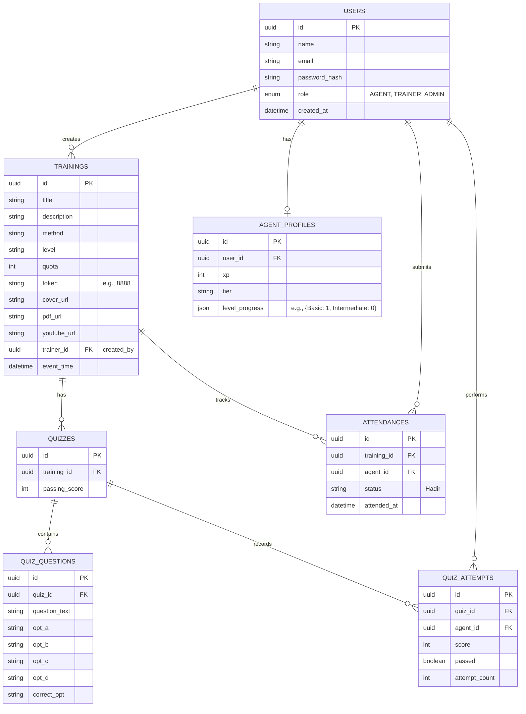

# Cetak Biru (Blueprint) Migrasi Backend ASM Academy

Dokumen ini berisi analisis komprehensif dan rencana arsitektur untuk memigrasikan aplikasi ASM Academy dari penyimpanan `localStorage` berbasis peramban (browser) ke ekosistem Backend API dan Database Relasional yang sesungguhnya.

## 1. Rekomendasi Tech Stack Modern

Untuk menjamin performa, skalabilitas, dan kemudahan pemeliharaan (*maintainability*), berikut adalah rekomendasi *stack* teknologi yang sangat ideal untuk arsitektur ini:

*   **Runtime & Framework:** **Node.js** dipadukan dengan **Express.js**. Kombinasi ini sangat ringan, memiliki ekosistem terbesar, dan sangat cocok untuk menjembatani aplikasi *frontend* berbasis JavaScript murni (Vanilla JS) yang Anda gunakan saat ini.
*   **Bahasa Pemrograman:** **TypeScript**. Sangat disarankan untuk menggunakan TypeScript di sisi backend agar struktur data dari *frontend* terdefinisi dengan ketat (mencegah *bug* seperti salah panggil properti Kuis).
*   **Database:** **PostgreSQL**. Sangat stabil, andal untuk relasi data kompleks (seperti modul ke kuis, agen ke histori absen), dan mendukung pencarian tingkat lanjut.
*   **ORM (Object-Relational Mapping):** **Prisma ORM**. Sangat modern, mudah dikonfigurasi, dan otomatis membuatkan tipe data yang sinkron dengan database.
*   **Autentikasi:** **JSON Web Tokens (JWT)** untuk menjaga sesi pengguna secara *stateless* dengan *Role-Based Access Control* (RBAC) agar rute Trainer tidak bisa ditembus oleh Agen.

---

## 2. Arsitektur Berbasis Layanan (Service-Oriented Architecture)

Untuk menjaga agar kode rapi dan tidak bercampur aduk, pola *Controller-Service-Route* harus diterapkan. Logika bisnis tidak boleh berada di dalam *Routes*.

1.  **Routes Layer:** Hanya bertugas menerima *request* HTTP (POST/GET), memvalidasi token JWT, dan meneruskannya.
2.  **Controller Layer:** Menangkap *request*, memanggil fungsi di *Service Layer*, dan mengembalikan *response* JSON.
3.  **Service Layer:** Di sinilah otak utama berada. Semua logika bisnis (seperti pengecekan apakah token absensi benar `8888`, penghitungan skor kuis, dan penambahan XP) diletakkan di sini.
4.  **Repository/Data Layer:** (Diurus oleh Prisma ORM) Bertugas berbicara langsung dengan PostgreSQL.

---

## 3. Rekomendasi Skema Database Relasional (PostgreSQL)

Berikut adalah desain tabel (*Entity-Relationship*) untuk menggantikan struktur `pa_trainings`, `pa_agent_progress`, dll.

---

## 4. Daftar Rute (Routes) Backend API

Berikut adalah penjabaran rute *endpoint* RESTful API untuk menghubungkan input Trainer hingga bisa dinikmati oleh Agen.

### A. Autentikasi & Pengguna (`/api/auth`)
| Metode | Endpoint | Dijalankan Oleh | Deskripsi (Logika Service) |
| :--- | :--- | :--- | :--- |
| **POST** | `/api/auth/login` | Publik | Memvalidasi email/password, mencetak token JWT dengan muatan (payload) `role` dan `user_id`. |
| **GET** | `/api/auth/me` | Semua Role | Mengambil profil pengguna yang sedang login berdasarkan JWT. |

### B. Modul Pelatihan (`/api/trainings`)
| Metode | Endpoint | Dijalankan Oleh | Deskripsi (Logika Service) |
| :--- | :--- | :--- | :--- |
| **POST** | `/api/trainings` | Trainer/Admin | Menyimpan data materi (judul, Youtube URL, PDF). Di sini *Service* mengekstrak ID Youtube dan mengamankan Token (misal: 8888). |
| **GET** | `/api/trainings` | Semua Role | Mengambil daftar pelatihan. Jika Agen, hanya tampilkan kuota dan materi. Jika Trainer, tampilkan analitik peserta. |
| **POST** | `/api/trainings/:id/attend` | Agen | Verifikasi token absensi. *Service* mencocokkan input Agen (8888) dengan `token` di tabel `TRAININGS`. Jika cocok, catat ke tabel `ATTENDANCES`. |

### C. Manajemen Kuis (`/api/quizzes`)
| Metode | Endpoint | Dijalankan Oleh | Deskripsi (Logika Service) |
| :--- | :--- | :--- | :--- |
| **POST** | `/api/quizzes/:training_id` | Trainer/Admin | Trainer mengirim *array* soal (maks 20 soal). *Service* akan melakukan perulangan (loop) untuk memasukkannya ke tabel `QUIZ_QUESTIONS`. |
| **GET** | `/api/quizzes/:training_id` | Agen | Agen mengambil soal kuis. **PENTING:** *Service* Backend HARUS membuang/menyembunyikan properti `correct_opt` sebelum mengirim data JSON ke *frontend* agar Agen tidak bisa berbuat curang dengan menginspeksi elemen! |
| **POST** | `/api/quizzes/:training_id/submit`| Agen | Mengirim jawaban Kuis. *Service* membandingkan jawaban Agen dengan `correct_opt` di DB, menghitung `score`, meng-update `QUIZ_ATTEMPTS`, dan jika lulus (>=70), otomatis memanggil *ProgressService* untuk menambah XP/Level. |

### D. Dasbor & Pelacakan Progres (`/api/progress`)
| Metode | Endpoint | Dijalankan Oleh | Deskripsi (Logika Service) |
| :--- | :--- | :--- | :--- |
| **GET** | `/api/progress/leaderboard`| Semua Role | Mengambil peringkat Agen berdasarkan agregasi XP dari tabel `AGENT_PROFILES`. |
| **GET** | `/api/progress/agent/:id` | Trainer/Admin | Trainer bisa memantau progres individual Agen (kelas apa saja yang sudah lulus). |

---

## 5. Ringkasan Alur Kerja Baru (Setelah Migrasi)

1.  **Trainer Membuat Materi & Kuis:** Di *frontend*, Trainer mengisi formulir. Data dikirim via `POST /api/trainings` dan `POST /api/quizzes`. Backend menyimpan relasinya ke tabel di PostgreSQL.
2.  **Agen Hadir:** Agen menginput token 8888. *Frontend* mengirim `POST /api/trainings/{id}/attend`. Backend memvalidasi, memberi respons "Sukses", lalu kunci Kuis terbuka di UI.
3.  **Agen Mengerjakan Kuis:** *Frontend* merender Kuis (tanpa kunci jawaban!). Saat Agen *submit*, `POST /api/quizzes/{id}/submit` dipanggil. Backend menghitung nilai secara tertutup. Jika lulus, Backend *update* tabel progres dan mengembalikan respons `{"passed": true, "score": 100, "xp_earned": 500}`.
4.  **Keamanan Mutlak:** Agen tidak akan pernah bisa memanipulasi *LocalStorage* untuk memalsukan nilai kelulusan atau menambah XP sendiri. Semua divalidasi oleh Backend API.
