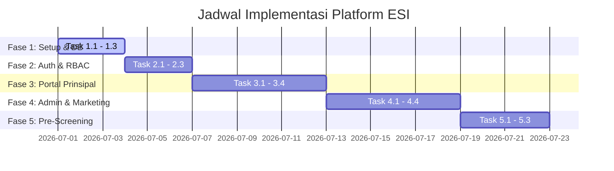

# Rencana Implementasi & Jadwal Task (Implementation Plan)
## Platform Pengajuan Energy Saving Insurance (ESI)

Platform ini akan dikembangkan menggunakan arsitektur monorepo terpisah antara Frontend (React.js + Tailwind CSS) dan Backend (Node.js + Express + Prisma ORM + PostgreSQL).

---

## Status Keputusan & Alur Terverifikasi

> [!NOTE]
> Rencana implementasi ini telah **DISETUJUI** oleh user pada 26 Juni 2026. Berikut adalah rangkuman keputusan parameter bisnis yang diintegrasikan ke sistem:

### Keputusan Bisnis & Teknis Terverifikasi

1. **Parameter Pre-Screening:**
   * **Keputusan:** Tidak ada batas minimal rasio penghematan energi yang kaku. Target bervariasi bergantung pada jenis produk dan teknologi efisiensi energi. Modul pre-screening akan didukung oleh **AI (LLM)** untuk mengecek isi berkas dokumen pengajuan. Jika terdeteksi kekurangan data atau ketidaksesuaian dokumen, AI secara otomatis mengirimkan notifikasi peringatan ke Prinsipal dan Admin.
2. **Integrasi Database ASM:**
   * **Keputusan:** AI akan diprogram untuk menganalisis berkas-berkas dokumen legalitas dan finansial secara otomatis, serta mencocokkan data profil dengan kriteria ASM. Notifikasi instan langsung dipicu ke admin dan user jika ada data yang kurang.
3. **Dokumen Persyaratan Wajib:**
   * **Keputusan:** Dokumen wajib diperluas menjadi **13 dokumen** (termasuk Surat Permohonan, Akte Pendirian/SK Kemenkumham/NIB, Rekening Koran, SPT Pengurus, Profil Produk, Perjanjian M&V, dll). Sistem didesain mendukung kolom data dinamis dan tipe dokumen kustom.
4. **Alur Approval Berjenjang:**
   * **Keputusan:** Persetujuan final diselesaikan melalui **Admin saja** (tanpa alur berjenjang ke Manager).
5. **Penetapan Cabang:**
   * **Keputusan:** **Admin Backoffice** yang akan menentukan dan menginput catatan cabang asal pendaftaran saat melakukan review awal di sistem. Ini otomatis mendistribusikan data ke dashboard Marketing Cabang terkait.

---

## Proposed Changes & Jadwal Task

Pengembangan akan dibagi menjadi 5 Fase Terschedule. Setiap task menyertakan informasi **Output** dan **Metode Testing**.

---

### Fase 1: Setup Proyek & Basis Data (Hari 1 - 3)
Fase ini berfokus pada inisialisasi lingkungan pengembangan dan pembuatan struktur database PostgreSQL.

*   **Task 1.1: Inisialisasi Monorepo (Frontend & Backend)**
    *   **Deskripsi:** Setup folder project backend (Express, Prisma) dan frontend (React, Vite, Tailwind CSS).
    *   **Output:** Repositori kode kosong dengan konfigurasi environment (.env) dan dependensi terinstal.
    *   **Bisa Ditesting?** **Tidak.** (Hanya setup folder dan build awal).
*   **Task 1.2: Pembuatan Skema Database & Migrasi (Mendukung Kolom Dinamis)**
    *   **Deskripsi:** Membuat skema PostgreSQL menggunakan Prisma ORM dengan menyertakan kolom JSONB `dynamic_fields` pada tabel `submissions` dan log AI pada tabel `documents` sesuai rancangan [TECHNICAL_DESIGN.md](file:///d:/AI 2/ESI/TECHNICAL_DESIGN.md).
    *   **Output:** Tabel-tabel database terbuat di PostgreSQL.
    *   **Bisa Ditesting?** **Ya.** Melalui perintah `prisma db push` dan verifikasi visual tabel menggunakan GUI Database Tool (DBeaver/pgAdmin).
*   **Task 1.3: Seeding Data Awal (Roles & Admin User)**
    *   **Deskripsi:** Menulis script seed untuk membuat data awal role (PRINCIPAL, ADMIN, MARKETING_CABANG) dan satu akun Admin bawaan.
    *   **Output:** Database berisi baris data awal siap pakai.
    *   **Bisa Ditesting?** **Ya.** Menjalankan script `node prisma/seed.js` dan memeriksa isi tabel `roles` dan `users`.

---

### Fase 2: Autentikasi, Registrasi & Hak Akses (Hari 4 - 6)
Fase ini mengimplementasikan registrasi akun Prinsipal, login, dan manajemen JWT.

*   **Task 2.1: API Register & Login JWT**
    *   **Deskripsi:** Membuat endpoint backend `/api/auth/register` (untuk Prinsipal) dan `/api/auth/login` (untuk semua role) dengan enkripsi password bcrypt.
    *   **Output:** Token JWT yang berisi data ID pengguna, Role, dan Branch Code.
    *   **Bisa Ditesting?** **Ya.** Menggunakan Postman/REST Client untuk mengirim request POST `/api/auth/register` dan `/api/auth/login` dan memverifikasi response token JWT.
*   **Task 2.2: Middleware Otorisasi (RBAC)**
    *   **Deskripsi:** Membuat middleware di backend untuk membatasi endpoint berdasarkan role pengguna.
    *   **Output:** Fungsi handler middleware `authorizeRoles(['ADMIN', 'MARKETING_CABANG'])`.
    *   **Bisa Ditesting?** **Ya.** Mengakses endpoint proteksi (seperti antrean admin) menggunakan JWT Prinsipal (harus menghasilkan error 403 Forbidden).
*   **Task 2.3: Halaman Login & Registrasi Frontend**
    *   **Deskripsi:** Membuat antarmuka pengguna (UI) untuk Login dan Registrasi Prinsipal di React.
    *   **Output:** Form login & registrasi dengan validasi input.
    *   **Bisa Ditesting?** **Ya.** Membuka browser, mengetik kredensial, menekan login, dan diarahkan ke dashboard kosong yang sesuai dengan role.

---

### Fase 3: Portal Prinsipal & Pengajuan Proyek ESI (Hari 7 - 12)
Fase ini membangun alur kerja utama bagi Prinsipal untuk mengajukan proyek asuransi.

*   **Task 3.1: Form Pengajuan Proyek Dinamis (UI)**
    *   **Deskripsi:** Membuat form di frontend untuk pengisian informasi teknologi, CapEx, OpEx, target penghematan energi, dan nominal moneternya.
    *   **Output:** Halaman form pengajuan proyek ESI yang interaktif.
    *   **Bisa Ditesting?** **Ya.** Mengisi form secara manual di web browser dan melihat data tervalidasi di sisi frontend.
*   **Task 3.2: Integrasi S3 Presigned URL & Uploader 13 Dokumen Wajib**
    *   **Deskripsi:** Membuat API backend untuk menghasilkan *presigned upload URL* AWS S3, dan membuat UI uploader file dinamis di frontend untuk mendukung 13 tipe dokumen wajib.
    *   **Output:** Ke-13 file dokumen terunggah secara langsung dan aman ke S3 bucket.
    *   **Bisa Ditesting?** **Ya.** Mengunggah dokumen dummy PDF melalui form, memeriksa apakah file masuk ke S3 bucket, dan memverifikasi data tersimpan di tabel `documents`.
*   **Task 3.3: API Simpan Draft & Submit Pengajuan**
    *   **Deskripsi:** Membuat endpoint `/api/submissions` untuk menyimpan draf dan endpoint `/api/submissions/:id/submit` untuk melakukan finalisasi pengajuan.
    *   **Output:** Data pengajuan tersimpan di database dengan status `Draft` atau `Submitted`.
    *   **Bisa Ditesting?** **Ya.** Mengirim data pengajuan, menyimpannya sebagai draf, lalu menekan tombol submit dan memverifikasi perubahan status di database.
*   **Task 3.4: Dashboard Tracking Prinsipal**
    *   **Deskripsi:** Membuat antarmuka dasbor bagi Prinsipal untuk melihat riwayat pengajuan dan statusnya.
    *   **Output:** Daftar pengajuan berstatus dinamis beserta riwayat catatan revisi.
    *   **Bisa Ditesting?** **Ya.** Login sebagai Prinsipal, masuk ke dasbor, dan memverifikasi daftar proyek beserta indikator status visual.

---

### Fase 4: Dashboard Admin & Dashboard Marketing Cabang (Hari 13 - 18)
Fase ini berfokus pada implementasi halaman verifikasi bagi Admin dan halaman pemantauan bagi Marketing Cabang.

*   **Task 4.1: Antrean Pengajuan Admin (Work Queue)**
    *   **Deskripsi:** Membuat halaman bagi Admin untuk melihat semua pengajuan masuk dengan status *Submitted* atau *Under Review*.
    *   **Output:** Tabel data pengajuan masuk yang dilengkapi fitur sortir dan filter.
    *   **Bisa Ditesting?** **Ya.** Login sebagai Admin, membuka dashboard, dan melihat daftar pengajuan dari semua prinsipal.
*   **Task 4.2: In-App Document Viewer, Verifikasi ASM & Input Cabang Asal**
    *   **Deskripsi:** Mengintegrasikan viewer PDF di dashboard review Admin, membuat tombol checklist pengecekan status ASM, serta form input bagi Admin untuk menetapkan wilayah cabang asal pengajuan.
    *   **Output:** Halaman tinjau data detail, pratinjau PDF, checklist ASM, dan input cabang.
    *   **Bisa Ditesting?** **Ya.** Klik tombol "Tinjau" pada pengajuan, melihat dokumen PDF tampil, memasukkan cabang asal, dan melihat perubahan alokasi cabang.
*   **Task 4.3: Feedback Loop Perbaikan (Need Revision)**
    *   **Deskripsi:** Membuat fitur bagi Admin untuk menandai kesalahan pada dokumen/field tertentu dan mengirimkannya kembali ke Prinsipal.
    *   **Output:** Transisi status pengajuan ke `Need_Revision` dan penyimpanan alasan revisi per item.
    *   **Bisa Ditesting?** **Ya.** Admin mengisi catatan revisi dokumen, menekan "Kembalikan", dan memastikan Prinsipal menerima notifikasi perubahan status serta kolom yang harus diperbaiki menjadi aktif kembali untuk diedit.
*   **Task 4.4: Dashboard Monitoring Marketing Cabang**
    *   **Deskripsi:** Membuat antarmuka khusus *read-only* bagi Marketing Cabang untuk melihat pengajuan Prinsipal di wilayah cabangnya.
    *   **Output:** Antrean pengajuan yang difilter otomatis berdasarkan kesamaan `branch_code`.
    *   **Bisa Ditesting?** **Ya.** Login sebagai user Marketing Cabang Jakarta, dan memverifikasi bahwa daftar pengajuan yang tampil **hanya** berasal dari Prinsipal wilayah Jakarta.

---

### Fase 5: Pre-Screening Engine & Uji Coba (Hari 19 - 22)
Fase ini berfokus pada otomatisasi skor kelayakan awal dan UAT (User Acceptance Testing) secara menyeluruh.

*   **Task 5.1: Implementasi AI Pre-Screening Engine (Backend - Gemini API)**
    *   **Deskripsi:** Mengembangkan modul backend terintegrasi dengan Gemini API untuk menganalisis isi ke-13 berkas PDF secara otomatis, mengekstrak data kunci, mendeteksi ketidaksesuaian/kerusakan dokumen, dan memicu notifikasi defisiensi instan jika ada data/dokumen yang kurang lengkap ke email Prinsipal dan Admin.
    *   **Output:** Log analisa AI per dokumen, total skor kelayakan, dan daftar bendera peringatan (*Warning Flags*) tersimpan di tabel `screening_results`.
    *   **Bisa Ditesting?** **Ya.** Memicu submit pada pengajuan dengan berkas dummy yang rusak atau tidak lengkap, dan memverifikasi notifikasi peringatan terkirim.
*   **Task 5.2: UAT Skenario End-to-End (Uji Kelayakan Aplikasi)**
    *   **Deskripsi:** Melakukan uji coba lengkap dari registrasi Prinsipal, submit pengajuan, kalkulasi pre-screening, pemantauan oleh Marketing, peninjauan Admin, hingga status Approved/Rejected.
    *   **Output:** Dokumen hasil uji coba (UAT log) yang memvalidasi kebenaran alur program.
    *   **Bisa Ditesting?** **Ya.** Menjalankan seluruh alur menggunakan 3 akun berbeda (Prinsipal, Marketing, Admin) secara bergantian di browser.

---

## Verification Plan

### Automated Tests
- Menjalankan unit testing pada backend untuk memverifikasi logika pre-screening:
  `npm run test:screening`
- Menjalankan integration testing untuk endpoint autentikasi dan otorisasi:
  `npm run test:auth`

### Manual Verification
- Melakukan verifikasi visual di browser untuk Portal Prinsipal, Dashboard Admin, dan Dashboard Marketing Cabang.
- Menguji pengunggahan dokumen PDF dengan format valid dan korup untuk memastikan validasi server bekerja dengan baik.
