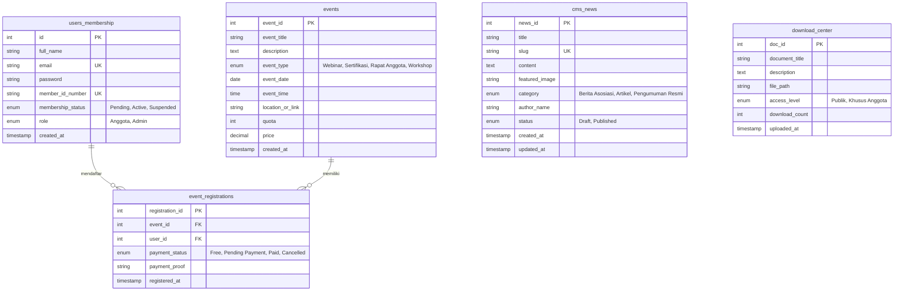

# Product Requirement Document (PRD): Web APMA (Asosiasi Profesi Marketing Asuransi)

**Versi:** 1.0.0  
**Tanggal:** 25 Agustus 2026  
**Status:** Draf Final / Berdasarkan Implementasi Kode  
**Teknologi Utama:** Node.js (Express.js), MySQL (`mysql2/promise`), Multer, Bcrypt, Nodemailer, Vanilla HTML5/CSS3 (Plus Jakarta Sans)

---

## 1. Ringkasan Eksekutif & Visi Produk

### 1.1 Visi Produk
Web **APMA (Asosiasi Profesi Marketing Asuransi)** dirancang sebagai platform digital terpusat untuk memperkuat profesionalisme pemasar asuransi umum di Indonesia. Platform ini memfasilitasi pendaftaran keanggotaan, manajemen lisensi & sertifikasi, pengolahan berita/pengumuman (CMS), pusat dokumen & regulasi, serta pendaftaran acara/webinar.

### 1.2 Tujuan Utama
1. **Digitalisasi Pendaftaran Anggota:** Memudahkan pendaftaran mandiri calon anggota dan input langsung oleh Admin dengan penomoran otomatis (`APMA-YYYY-XXXX`).
2. **Otomatisasi Credential & Notifikasi:** Menghasilkan nomor anggota, hashing kata sandi sementara secara aman, pencatatan log audit sistem, serta pengiriman email sambutan HTML via Nodemailer.
3. **Pusat Informasi & Unduhan Terkontrol:** Menyediakan repositori regulasi dan materi edukasi dengan pembagian hak akses (Publik vs Khusus Anggota).
4. **Manajemen Acara & Sertifikasi:** Memfasilitasi pendaftaran event/webinar/pelatihan serta pemantauan status keanggotaan dan sertifikasi.

---

## 2. Pengguna Target & Peran (User Roles)

| Peran Pengguna | Deskripsi | Hak Akses Utamanya |
|---|---|---|
| **Pengunjung / Publik** | Calon anggota atau praktisi industri asuransi yang mengakses web publik. | Viewing landing page, membaca berita/pengumuman publik, melihat agenda acara, mengunduh dokumen publik, mendaftar keanggotaan. |
| **Anggota (Member)** | Pemegang lisensi/sertifikasi yang terdaftar di APMA. | Mengakses **Portal Anggota**, melihat profil & nomor ID keanggotaan, memantau status sertifikasi, mengunduh dokumen khusus anggota, mendaftar event/webinar. |
| **Administrator (Admin)** | Pengelola sistem dan pengurus asosiasi. | Mengakses **Admin Center**, memantau statistik platform, mempublikasikan berita/CMS, membuat acara baru, mengunggah dokumen regulasi, dan menambahi anggota baru secara manual. |

---

## 3. Fitur & Modul Fungsional

### Modul 1: Web Publik & Landing Page (`index.html`)
- **Navigasi Utama:** Beranda, Tentang Kami, Keanggotaan, Pusat Informasi, Berita, Kontak, dan Portal Anggota.
- **Hero & Call to Action (CTA):** Informasi keunggulan APMA dengan tombol pendaftaran anggota.
- **Berita & Pengumuman:** Menampilkan daftar artikel & pengumuman terbaru (`/api/news`).
- **Pusat Unduhan Publik:** Akses dokumen publik bagi pengunjung biasa (`/api/downloads?isLoggedIn=false`).

### Modul 2: Pendaftaran Anggota & Otomatisasi (`public_register.html`, `admin_add_member.html`, `onAfterAdminInsertMember.js`)
- **Pendaftaran Mandiri (Public Registration):**
  - Form data pribadi: Nama Lengkap, Email, Nomor HP, Perusahaan Asuransi, Tingkat Sertifikasi (Dasar / Madya / Utama).
  - Upload dokumen persyaratan (Format: JPG, PNG, PDF, Maks: 2MB).
- **Penambahan Anggota oleh Admin (Direct Admin Insert):**
  - Endpoint `POST /api/admin/add-member`.
  - **Triggers Logic (`onAfterAdminInsertMember`):**
    1. **Format Penomoran Anggota:** Otomatis menghasilkan `APMA-2026-XXXX` (padding 4 digit).
    2. **Hashing Password:** Password sementara `ApmaSecure2026!` di-hash menggunakan `bcrypt` (salt rounds: 10).
    3. **System Logging:** Mencatat aksi `INSERT_NEW_MEMBER` ke log sistem dengan aktor admin penginput.
    4. **Email Notification:** Mengirimkan email HTML sambutan berisi Nomor Anggota dan Kata Sandi Sementara via `Nodemailer`.

### Modul 3: Portal Anggota (`member_dashboard.html`)
- **Kartu Profil & Status Anggota:** Menampilkan Nama, Nomor Anggota (`APMA-2026-XXXX`), Status (`Active` / `Pending` / `Suspended`), dan Tanggal Masuk.
- **Status Lisensi & Sertifikasi:** Menampilkan masa berlaku lisensi (misal: *LSMU - Level Madya*) dan tombol perpanjangan.
- **Keterlibatan Acara (Event Enrolled):** Daftar webinar/workshop yang sedang dan telah diikuti.
- **Pusat Unduhan Anggota:** Akses eksklusif dokumen internal/regulasi (`/api/downloads?isLoggedIn=true`).

### Modul 4: Pusat Kontrol Admin (`admin_dashboard.html`)
- **Dashboard Statistik:**
  - Total Anggota Terdaftar (misal: 1,248)
  - Total Berita Dipublikasi (misal: 34)
  - Agenda Acara Mendatang (misal: 5)
- **Form Pengelolaan Konten (CMS):**
  - **Tambah Berita:** Judul, Kategori (`Berita Asosiasi`, `Artikel`, `Pengumuman Resmi`), Konten (`POST /api/news`).
  - **Tambah Agenda Acara:** Judul Acara, Deskripsi, Tipe (`Webinar`, `Sertifikasi`, `Rapat Anggota`, `Workshop`), Tanggal, Waktu, Lokasi/Link Zoom (`POST /api/events`).
  - **Unggah Dokumen:** Judul Dokumen, Tingkat Akses (`Publik`, `Khusus Anggota`), File Dokumen (`POST /api/downloads`).

---

## 4. Arsitektur REST API Endpoints

| Method | Endpoint | Deskripsi | Akses |
|---|---|---|---|
| `GET` | `/api/news` | Mengambil daftar berita berstatus *Published* | Publik |
| `POST` | `/api/news` | Mempublikasikan berita baru | Admin |
| `GET` | `/api/downloads` | Mengambil daftar dokumen (filter berdasarkan status login) | Publik / Member |
| `POST` | `/api/downloads` | Mengunggah dokumen baru (PDF/Image) | Admin |
| `POST` | `/api/events` | Membuat agenda acara/webinar baru | Admin |
| `POST` | `/api/events/register` | Mendaftar ke suatu event/webinar | Member |
| `POST` | `/api/admin/add-member` | Menambah anggota baru & memicu otomatisasi `onAfterAdminInsertMember` | Admin |

---

## 5. Skema Basis Data (Database Schema)

Sistem menggunakan **MySQL** dengan tabel-tabel berikut:

---

## 6. Persyaratan Non-Fungsional (Non-Functional Requirements)

1. **Keamanan (Security):**
   - Hashing kata sandi menggunakan `bcrypt` (10 rounds).
   - Validasi ketat format file unggahan via Multer (hanya `jpeg`, `jpg`, `png`, `pdf`).
   - Batas maksimal ukuran unggahan file: 2MB.
   - Parameterized queries (`mysql2/promise`) untuk mencegah SQL Injection.
2. **Performa & Skalabilitas:**
   - Database Connection Pooling (`connectionLimit: 10`).
   - Static asset serving langsung via Express Middleware.
3. **Desain & Antarmuka Pengguna (UI/UX):**
   - Menggunakan palette warna eksklusif: Crimson Maroon (`#991b1b`) & Deep Navy (`#0f172a`).
   - Typography modern dengan font Google *Plus Jakarta Sans*.
   - Responsive Layout yang optimal di tampilan Desktop & Mobile.

---

## 7. Rencana Pengembangan Selanjutnya (Future Roadmap)

- **Fase 2:** Integrasi Payment Gateway (Midtrans/Xendit) untuk pembayaran pendaftaran acara dan pendaftaran anggota berbayar.
- **Fase 3:** Fitur Otomatis Generator Kartu Tanda Anggota (KTA Digital) berbasis QR Code & PDF.
- **Fase 4:** Sistem verifikasi email (Email Verification Link) dan fitur Lupa Password mandiri.
